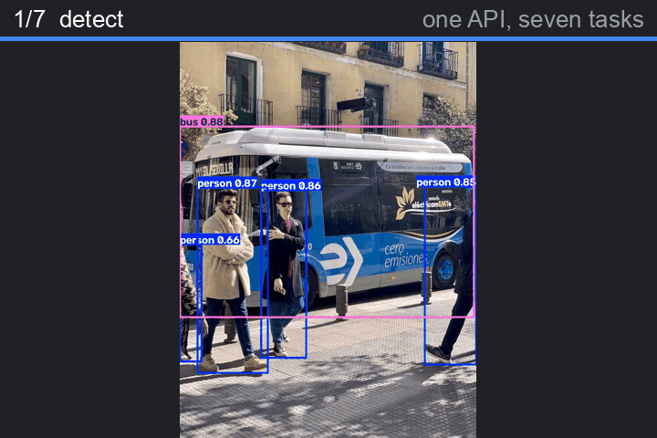
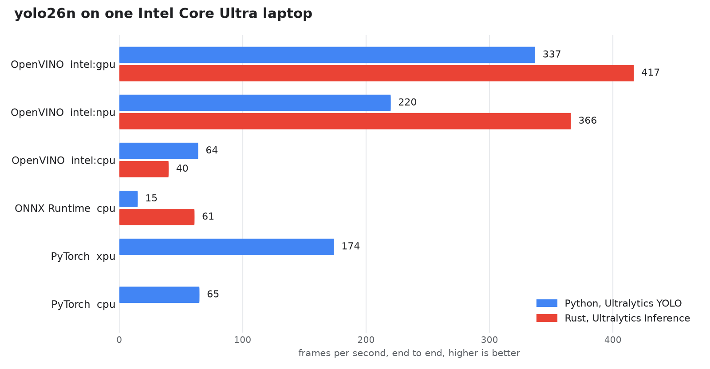

<div align="center">

<picture><source media="(prefers-color-scheme: dark)" srcset="docs/assets/logos/gdg-samsun-white.svg"></picture> <picture><source media="(prefers-color-scheme: dark)" srcset="docs/assets/logos/ultralytics-logo-white.svg"></picture>

# No GPU Left Behind

**Hybrid Ultralytics YOLO training and fast execution on any laptop, from the cloud to Rust in 60 minutes**

[](https://colab.research.google.com/github/onuralpszr/gdg-samsun-etkinlik-2026-workshop/blob/main/notebooks/hybrid_yolo_workshop.ipynb)
[](https://onuralpszr.github.io/gdg-samsun-etkinlik-2026-workshop/)
[](https://onuralpszr.github.io/gdg-samsun-etkinlik-2026-workshop/tr/)
[](https://platform.ultralytics.com)
[](https://crates.io/crates/ultralytics-inference)
[](https://github.com/onuralpszr/gdg-samsun-etkinlik-2026-workshop/actions/workflows/pages.yml)



</div>

## Overview

You do not need a giant GPU to do serious computer vision. In this GDG Samsun DevFest 2026 workshop we train an Ultralytics YOLO model on whatever you brought (an NVIDIA card, an Intel laptop with Arc graphics and an NPU, a MacBook or a plain CPU), stream the run to the **Ultralytics Platform**, export it to **ONNX**, **OpenVINO** and **TensorRT**, and ship it as a tiny Rust binary with **Ultralytics Inference**.

| Step | You will | Files |
|---|---|---|
| 0 Setup | Build a `.venv` with the right PyTorch for your hardware plus OpenVINO and check every accelerator | `setup_env.sh`, `local_python/00_check_env.py` |
| 1 Train | Log in to the Ultralytics Platform and train `yolo26n.pt` locally with live cloud metrics | `local_python/01_hybrid_train.py` |
| Playground | Seven tasks, tracking, webcam, Solutions, auto annotation and the Platform API | `local_python/03` to `08` |
| 2 Export | Export to ONNX, OpenVINO and TensorRT and race every format on every device | `local_python/02_export_model.py` |
| 3 Ship | Run the model from the `ultralytics-inference` CLI and Rust crate | `local_inference/` |

The full guide with pictures lives on the **[workshop page](https://onuralpszr.github.io/gdg-samsun-etkinlik-2026-workshop/)**.

## Agenda

| Time | Block | What happens |
|---|---|---|
| 00:00 | Warm up | Who has a GPU? Who has an NPU? Nobody gets left behind |
| 00:05 | Step 0 | Prerequisites check and Ultralytics Platform login |
| 00:12 | Step 1 | Hybrid training on your laptop plus a cloud training tour |
| 00:25 | Playground | Seven tasks, tracking, Solutions and auto annotation |
| 00:35 | Step 2 | Export and the great speed race |
| 00:45 | Step 3 | Ultralytics Inference in Rust: CLI, batch, video and webcam |
| 00:55 | Wrap up | Live webcam showdown and questions |

## Architecture

```mermaid
flowchart TB
    subgraph Data["Data"]
        direction LR
        A[Your images] --> B[Auto annotation with YOLO, SAM or vision language models]
        B --> C[(Ultralytics Platform dataset)]
    end
    subgraph Train["Step 1 Train"]
        direction LR
        C --> D{Where?}
        D -->|Cloud GPU| E[Ultralytics Platform cloud training]
        D -->|Your laptop| F[Local training on CUDA, XPU, MPS or CPU]
        F -.->|live metrics and checkpoints| G[Ultralytics Platform dashboard]
        E --> G
    end
    subgraph Export["Step 2 Export"]
        direction LR
        G --> H[best.pt]
        F --> H
        H --> I[ONNX]
        H --> J[OpenVINO]
        H --> K[TensorRT FP16]
    end
    subgraph Run["Step 3 Run"]
        direction LR
        I --> L[ultralytics-inference CLI]
        J --> L
        I --> M[Rust crate app]
        J --> M
        K --> N[Python on NVIDIA]
        I --> P[TensorRT FP16 in Rust on NVIDIA]
        J --> O[Intel CPU, GPU and NPU]
    end
```



## Step 0: Prerequisites check

```bash
git clone https://github.com/onuralpszr/gdg-samsun-etkinlik-2026-workshop.git
cd gdg-samsun-etkinlik-2026-workshop
./setup_env.sh          # Intel GPU and NPU laptops (PyTorch XPU plus OpenVINO)
./setup_env.sh cuda     # NVIDIA machines
./setup_env.sh cpu      # Apple silicon (MPS) and any other machine
source .venv/bin/activate
python local_python/00_check_env.py
```

You need Python 3.11 or newer, `ultralytics` 8.4.120 or newer, an [Ultralytics Platform](https://platform.ultralytics.com) account, and Rust 1.92 or newer for Step 3. FFmpeg development libraries unlock video and webcam in Rust.

> [!TIP]
> Prefer the browser? Press **Open in Colab** above and pick the T4 GPU runtime. Nothing to install.

## Step 1: Ultralytics Platform authentication and hybrid training

1. Sign up at [platform.ultralytics.com](https://platform.ultralytics.com). New accounts get free credits.
2. Open **Settings > API Keys** and create a key with the training scope.
3. Log in once:

```bash
yolo login ul_your_api_key        # or: export ULTRALYTICS_API_KEY=ul_your_api_key
```

Train on your own hardware while the Platform shows live metrics. `project="username/project"` is the switch that turns streaming on.

```bash
# device=0 for NVIDIA CUDA, device=xpu for Intel GPU, device=mps for Apple silicon, device=cpu for any machine
yolo train model=yolo26n.pt data=coco8.yaml epochs=10 device=0 project=your_username/gdg-samsun name=laptop-run
```

```python
from ultralytics import YOLO

model = YOLO("yolo26n.pt")
# device: 0 for NVIDIA CUDA, "xpu" for Intel GPU, "mps" for Apple silicon, "cpu" for any machine
model.train(data="coco8.yaml", epochs=10, device=0, project="your_username/gdg-samsun", name="laptop-run")
```

`local_python/01_hybrid_train.py` is the same code in a file that picks the best device on its own. Put your username in `PROJECT` at the top.

Want a cloud GPU instead? Open your project on the Platform, click **New Model**, pick `YOLO26n` and a dataset, choose a GPU and press **Start Training**. Datasets on the Platform train locally too with `data=ul://your_username/datasets/your_dataset`.

Ten epochs on `coco8.yaml` take about **18 seconds** on a laptop GPU and reach **mAP50 0.941**.


## Playground

[](https://github.com/ultralytics/ultralytics/actions/workflows/ci.yml)
[](https://pypi.org/project/ultralytics/)
[](https://clickpy.clickhouse.com/dashboard/ultralytics)
[](https://pypi.org/project/ultralytics/)
[](https://discord.com/invite/ultralytics)
[](https://community.ultralytics.com)
[](https://www.reddit.com/r/ultralytics/)
[](https://colab.research.google.com/github/ultralytics/ultralytics/blob/main/examples/tutorial.ipynb)
[](https://www.kaggle.com/models/ultralytics/yolo26)

| Script | Same idea from the CLI |
|---|---|
| `03_all_tasks.py` runs all seven tasks | `yolo predict model=yolo26n-pose.pt source=https://ultralytics.com/images/zidane.jpg` |
| `04_track.py` tracks every person in a video | `yolo track model=yolo26n.pt source=video.mp4 tracker=bytetrack.yaml` |
| `05_webcam.py` shows live FPS on your webcam | `yolo predict model=yolo26n_openvino_model source=0 device=intel:gpu show=True` |
| `06_solutions.py count` counts, maps heat, blurs or measures speed | `yolo solutions heatmap source=video.mp4 show=True` |
| `07_auto_annotate.py` labels images with Ultralytics YOLO plus SAM | Smart Annotation on the Ultralytics Platform with SAM, YOLO and vision language models |
| `08_platform_tour.py` lists free cloud GPUs and your projects | `yolo login YOUR_API_KEY` first to see your account |

<table>
<tr>
<td><br><b>detect</b></td>
<td><br><b>segment</b></td>
<td><br><b>semantic</b></td>
<td><br><b>depth</b></td>
</tr>
<tr>
<td><br><b>classify</b></td>
<td><br><b>pose</b></td>
<td><br><b>obb</b></td>
<td><br><b>auto annotation</b></td>
</tr>
</table>

 

## Step 2: Export to ONNX, OpenVINO and TensorRT

```bash
yolo export model=yolo26n.pt format=onnx simplify=True      # runs everywhere

# Intel CPU, GPU and NPU
yolo export model=yolo26n.pt format=openvino
yolo export model=yolo26n.pt format=engine half=True        # NVIDIA TensorRT FP16

# export, then race every format on every device
python local_python/02_export_model.py
```

Output of `02_export_model.py` on an Intel Core Ultra X7 358H with Arc B390 graphics and the built in NPU, `yolo26n.pt` at 640, median of 100 runs. FPS is 1000 divided by the end to end time.

| Format | Device | Inference (ms) | End to end (ms) | FPS |
|---|---|---:|---:|---:|
| PyTorch | cpu | 14.39 | 15.50 | 65 |
| PyTorch | xpu | 3.53 | 5.74 | 174 |
| ONNX | cpu | 28.38 | 67.14 | 15 |
| OpenVINO | intel:cpu | 14.31 | 15.71 | 64 |
| OpenVINO | intel:gpu | 1.87 | 2.97 | 337 |
| OpenVINO | intel:npu | 3.09 | 4.54 | 220 |

## Step 3: High speed execution with Ultralytics Inference

[](https://crates.io/crates/ultralytics-inference)
[](https://docs.rs/ultralytics-inference)
[](https://crates.io/crates/ultralytics-inference)
[](https://crates.io/crates/ultralytics-inference)
[](https://github.com/ultralytics/inference/actions/workflows/ci.yml)
[](https://app.codecov.io/github/ultralytics/inference)
[](https://github.com/ultralytics/inference/blob/main/LICENSE)
[](https://deps.rs/repo/github/ultralytics/inference)
[](https://arxiv.org/abs/2606.03748)
[](https://discord.com/invite/ultralytics)

```bash
cargo install ultralytics-inference --features "openvino-native,video"
export LD_LIBRARY_PATH=$(python -c "import openvino, os; print(os.path.dirname(openvino.__file__))")/libs

# single image
ultralytics-inference predict --model yolo26n.onnx --source bus.jpg

# batch
ultralytics-inference predict --model yolo26n.onnx --source images/ --batch 4
ultralytics-inference predict --model yolo26n_openvino_model --device intel:gpu --source video.mp4
ultralytics-inference predict --model yolo26n_openvino_model --device intel:npu --source 0 --show

# NVIDIA TensorRT FP16 from ONNX, build with --features nvidia
ultralytics-inference predict --model yolo26n.onnx --device tensorrt:0 --quantize 16 --source bus.jpg

# the whole tour
./local_inference/run_cli.sh all
```

All seven tasks work in Rust too. `./local_inference/run_cli.sh tasks` runs each one and saves the results under `runs/<task>/`:

<table>
<tr>
<td><br><b>detect</b></td>
<td><br><b>segment</b></td>
<td><br><b>semantic</b></td>
<td><br><b>depth</b></td>
</tr>
<tr>
<td><br><b>classify</b></td>
<td><br><b>pose</b></td>
<td colspan="2"><br><b>obb</b></td>
</tr>
</table>

The Cargo project in `local_inference/` uses the crate directly with image, batch, video and bench modes:

```bash
cargo build --release --manifest-path local_inference/Cargo.toml --features "openvino,video"
DEVICE=intel:gpu local_inference/target/release/gdg-inference video yolo26n_openvino_model video.mp4
```

<picture><source media="(prefers-color-scheme: dark)" srcset="docs/assets/img/fps_en_dark.png"></picture>

| Engine | Device | Inference (ms) | End to end (ms) | FPS |
|---|---|---:|---:|---:|
| ONNX Runtime | cpu | 15.65 | 16.33 | 61 |
| OpenVINO | intel:cpu | 24.63 | 25.30 | 40 |
| OpenVINO with THREADS=16 | intel:cpu | 15.04 | 15.80 | 63 |
| OpenVINO | intel:gpu | 1.91 | 2.40 | 417 |
| OpenVINO | intel:npu | 2.19 | 2.73 | 366 |

| Runtime | Engine and device | Frames | FPS | Peak memory |
|---|---|---:|---:|---:|
| Python Ultralytics YOLO `predict(stream=True)` | OpenVINO on intel:gpu | 620 | 283 | 942 MB |
| Rust `gdg-inference video` (Ultralytics Inference crate) | OpenVINO on intel:gpu | 620 | 400 | 284 MB |

The Rust binary is 37 MB with no Python at runtime. It runs video 1.4x faster with 3.3x less memory.

## Repository layout

| Path | What it is |
|---|---|
| `setup_env.sh` | Builds `.venv` with PyTorch for CUDA, Intel XPU or CPU plus OpenVINO |
| `requirements.txt` | Workshop Python packages |
| `local_python/00_check_env.py` | Shows your PyTorch device, OpenVINO devices, Rust CLI and Platform key |
| `local_python/01_hybrid_train.py` | Trains locally with live Ultralytics Platform metrics |
| `local_python/02_export_model.py` | Exports to ONNX and OpenVINO, then races every format on every device |
| `local_python/03_all_tasks.py` | detect, segment, semantic, depth, classify, pose and obb |
| `local_python/04_track.py` | Tracks every person in a video |
| `local_python/05_webcam.py` | Live webcam with an FPS counter |
| `local_python/06_solutions.py` | Counting, heatmap, privacy blur and speed estimation |
| `local_python/07_auto_annotate.py` | Auto annotation with Ultralytics YOLO and SAM |
| `local_python/08_platform_tour.py` | Cloud GPU availability, plus your account and projects |
| `local_python/device_utils.py` | Picks NVIDIA CUDA, Intel XPU, Apple MPS or CPU |
| `local_inference/Cargo.toml` and `src/main.rs` | Rust app on the `ultralytics-inference` crate |
| `local_inference/run_cli.sh` | `ultralytics-inference` CLI tour |
| `notebooks/hybrid_yolo_workshop.ipynb` | The whole workshop in Google Colab |
| `docs/` | GitHub Pages site built with MkDocs Material |
| `tools/` | Notebook generator, page charts and GIFs, and the prose style checker |
| `.github/workflows/pages.yml` | Deploys the docs on every push to `main` |

## Build the docs locally

```bash
uv pip install -r requirements-docs.txt
mkdocs serve
```

## License

Code is released under the [AGPL 3.0 License](LICENSE), matching Ultralytics YOLO and Ultralytics Inference.

<div align="center">

**No GPU was left behind today. Teşekkürler Samsun!**

</div>
