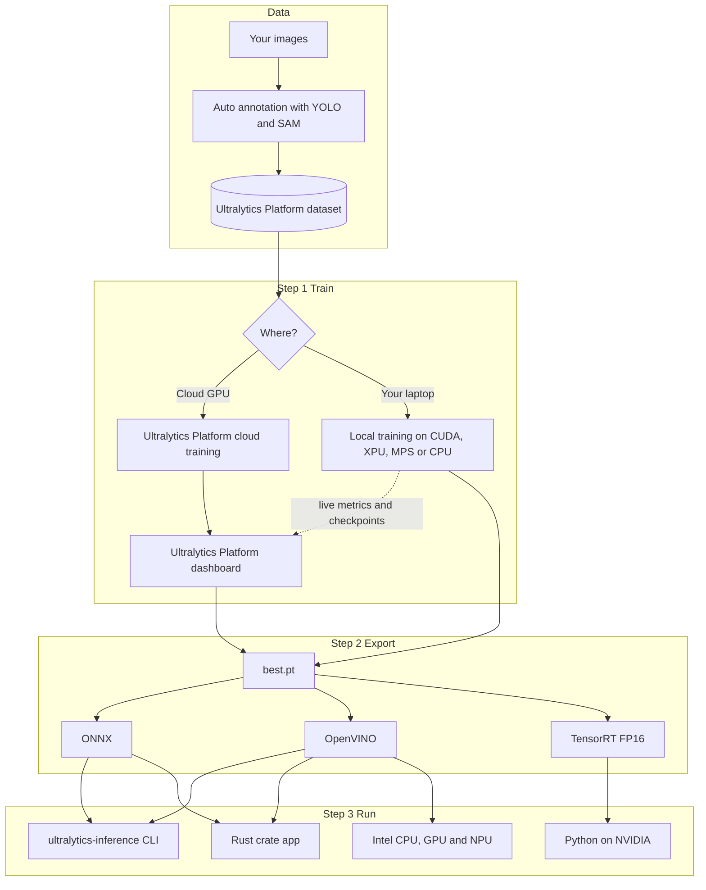

<div align="center">

 

# No GPU Left Behind

**Hybrid Ultralytics YOLO training and fast execution on any laptop, from the cloud to Rust in 60 minutes**

[](https://colab.research.google.com/github/onuralpszr/gdg-samsun-etkinlik-2026-workshop/blob/main/notebooks/hybrid_yolo_workshop.ipynb)
[](https://onuralpszr.github.io/gdg-samsun-etkinlik-2026-workshop/)
[](https://onuralpszr.github.io/gdg-samsun-etkinlik-2026-workshop/tr/)
[](https://platform.ultralytics.com)
[](https://crates.io/crates/ultralytics-inference)
[](https://github.com/onuralpszr/gdg-samsun-etkinlik-2026-workshop/actions/workflows/pages.yml)

</div>

## Overview

You do not need a giant GPU to do serious computer vision. In this GDG Samsun DevFest 2026 workshop we train an Ultralytics YOLO model on whatever you brought (an NVIDIA card, an Intel laptop with Arc graphics and an NPU, a MacBook or a plain CPU), stream the run to the **Ultralytics Platform**, export it to **ONNX**, **OpenVINO** and **TensorRT**, and ship it as a tiny Rust binary with **Ultralytics Inference**.

| Step | You will | Files |
|---|---|---|
| 0 Setup | Build a `.venv` with PyTorch XPU, CUDA or CPU plus OpenVINO and check every accelerator | `setup_env.sh`, `local_python/00_check_env.py` |
| 1 Train | Log in to the Ultralytics Platform and train `yolo26n.pt` locally with live cloud metrics | `local_python/01_hybrid_train.py` |
| Playground | Seven tasks, tracking, webcam, Solutions, auto annotation and the Platform API | `local_python/03` to `08` |
| 2 Export | Export to ONNX, OpenVINO and TensorRT and race every format on every device | `local_python/02_export_model.py` |
| 3 Ship | Run the model from the `ultralytics-inference` CLI and Rust crate | `local_inference/` |

The full guide with pictures lives on the **[workshop page](https://onuralpszr.github.io/gdg-samsun-etkinlik-2026-workshop/)**.

## Agenda

| Time | Block | What happens |
|---|---|---|
| 00:00 | Warm up | Who has a GPU? Who has an NPU? Nobody gets left behind |
| 00:05 | Step 0 | Prerequisites check and Ultralytics Platform login |
| 00:12 | Step 1 | Hybrid training on your laptop plus a cloud training tour |
| 00:25 | Playground | Seven tasks, tracking, Solutions and auto annotation |
| 00:35 | Step 2 | Export and the great speed race |
| 00:45 | Step 3 | Ultralytics Inference in Rust: CLI, batch, video and webcam |
| 00:55 | Wrap up | Live webcam showdown and questions |

## Architecture



## Step 0: Prerequisites check

```bash
git clone https://github.com/onuralpszr/gdg-samsun-etkinlik-2026-workshop.git
cd gdg-samsun-etkinlik-2026-workshop
./setup_env.sh          # Intel GPU and NPU laptops (PyTorch XPU plus OpenVINO)
./setup_env.sh cuda     # NVIDIA machines
./setup_env.sh cpu      # anything else
source .venv/bin/activate
python local_python/00_check_env.py
```

You need Python 3.11 or newer, `ultralytics` 8.4.120 or newer, an [Ultralytics Platform](https://platform.ultralytics.com) account, and Rust 1.92 or newer for Step 3. FFmpeg development libraries unlock video and webcam in Rust.

> [!TIP]
> Prefer the browser? Press **Open in Colab** above and pick the T4 GPU runtime. Nothing to install.

## Step 1: Ultralytics Platform authentication and hybrid training

1. Sign up at [platform.ultralytics.com](https://platform.ultralytics.com). New accounts get free credits.
2. Open **Settings > API Keys** and create a key with the training scope.
3. Log in once:

```bash
yolo login ul_your_api_key        # or: export ULTRALYTICS_API_KEY=ul_your_api_key
```

Train on your own hardware while the Platform shows live metrics. `project="username/project"` is the switch that turns streaming on.

```bash
python local_python/01_hybrid_train.py --model yolo26n.pt --data coco8.yaml --epochs 10 --device xpu --project gdg-samsun
```

```python
from ultralytics import YOLO

model = YOLO("yolo26n.pt")
model.train(data="coco8.yaml", epochs=10, device="xpu", project="your_username/gdg-samsun", name="laptop-run")
```

Want a cloud GPU instead? Open your project on the Platform, click **New Model**, pick `YOLO26n` and a dataset, choose a GPU and press **Start Training**. Datasets on the Platform train locally too with `data=ul://your_username/datasets/your_dataset`.

Ten epochs on `coco8.yaml` take **18 seconds** on the Intel Arc B390 laptop GPU with PyTorch XPU and reach **mAP50 0.941**.


## Playground

| Script | What it does |
|---|---|
| `03_all_tasks.py` | detect, segment, semantic, depth, classify, pose and obb with one API |
| `04_track.py` | multi object tracking with six trackers on video or webcam |
| `05_webcam.py` | live webcam with an FPS counter, swap engines on the fly |
| `06_solutions.py` | counting, heatmap, privacy blur and speed estimation |
| `07_auto_annotate.py` | YOLO segmentation labels for free with Ultralytics YOLO plus SAM |
| `08_platform_tour.py` | GPU availability, account, projects and remote predict on the Ultralytics Platform |

<table>
<tr>
<td><br><b>detect</b></td>
<td><br><b>segment</b></td>
<td><br><b>semantic</b></td>
<td><br><b>depth</b></td>
</tr>
<tr>
<td><br><b>classify</b></td>
<td><br><b>pose</b></td>
<td><br><b>obb</b></td>
<td><br><b>auto annotation</b></td>
</tr>
</table>

 

## Step 2: Export to ONNX, OpenVINO and TensorRT

```bash
python local_python/02_export_model.py                      # ONNX with simplify=True plus OpenVINO, then race
python local_python/02_export_model.py --tensorrt           # adds TensorRT with half=True on NVIDIA
```

Intel Core Ultra X7 358H with Arc B390 graphics and the built in NPU, `yolo26n.pt` at 640, median of 100 runs:

| Format | Device | Size (MB) | Inference (ms) | End to end (ms) | FPS | Speedup | Objects |
|---|---|---:|---:|---:|---:|---:|---:|
| PyTorch | cpu | 5.5 | 14.6 | 15.7 | 69 | 1.0x | 5 |
| PyTorch | xpu | 5.5 | 3.2 | 5.3 | 312 | 4.6x | 5 |
| ONNX | cpu | 9.9 | 42.4 | 83.6 | 24 | 0.3x | 5 |
| OpenVINO | intel:cpu | 10.1 | 15.2 | 16.7 | 66 | 1.0x | 5 |
| OpenVINO | intel:gpu | 10.1 | 1.9 | 3.0 | 532 | 7.8x | 5 |
| OpenVINO | intel:npu | 10.1 | 3.2 | 4.7 | 316 | 4.6x | 5 |

## Step 3: High speed execution with Ultralytics Inference

```bash
cargo install ultralytics-inference --features "openvino-native,video"
export LD_LIBRARY_PATH=$(python -c "import openvino, os; print(os.path.dirname(openvino.__file__))")/libs

ultralytics-inference predict --model yolo26n.onnx --source bus.jpg                          # single image
ultralytics-inference predict --model yolo26n.onnx --source images/ --batch 4                # batch
ultralytics-inference predict --model yolo26n_openvino_model --device intel:gpu --source video.mp4
ultralytics-inference predict --model yolo26n_openvino_model --device intel:npu --source 0 --show

./local_inference/run_cli.sh all                                                              # the whole tour
```

The Cargo project in `local_inference/` uses the crate directly with image, batch, video and bench modes:

```bash
cargo build --release --manifest-path local_inference/Cargo.toml --features "openvino,video"
DEVICE=intel:gpu local_inference/target/release/gdg-inference video yolo26n_openvino_model video.mp4
```

| Engine | Device | Inference (ms) | End to end (ms) | FPS |
|---|---|---:|---:|---:|
| ONNX Runtime | cpu | 15.65 | 16.33 | 61 |
| OpenVINO | intel:cpu | 24.63 | 25.30 | 40 |
| OpenVINO with THREADS=16 | intel:cpu | 15.04 | 15.80 | 63 |
| OpenVINO | intel:gpu | 1.91 | 2.40 | 417 |
| OpenVINO | intel:npu | 2.19 | 2.73 | 366 |

| Runtime | Engine and device | Frames | FPS | Peak memory |
|---|---|---:|---:|---:|
| Python Ultralytics YOLO `predict(stream=True)` | OpenVINO on intel:gpu | 620 | 283 | 942 MB |
| Rust `gdg-inference video` (Ultralytics Inference crate) | OpenVINO on intel:gpu | 620 | 400 | 284 MB |

The Rust binary is 37 MB with no Python at runtime. It runs video 1.4x faster with 3.3x less memory.

## Repository layout

| Path | What it is |
|---|---|
| `setup_env.sh` | Builds `.venv` with PyTorch XPU, CUDA or CPU plus OpenVINO |
| `requirements.txt` | Workshop Python packages |
| `local_python/00_check_env.py` | Prerequisites check for every accelerator |
| `local_python/01_hybrid_train.py` | Ultralytics Platform login and hybrid training |
| `local_python/02_export_model.py` | ONNX, OpenVINO and TensorRT export plus the speed race |
| `local_python/03_all_tasks.py` | detect, segment, semantic, depth, classify, pose and obb |
| `local_python/04_track.py` | Multi object tracking on video or webcam |
| `local_python/05_webcam.py` | Live webcam with an FPS counter |
| `local_python/06_solutions.py` | Counting, heatmap, privacy blur and speed estimation |
| `local_python/07_auto_annotate.py` | Auto annotation with Ultralytics YOLO and SAM |
| `local_python/08_platform_tour.py` | Ultralytics Platform Python client tour |
| `local_inference/Cargo.toml` and `src/main.rs` | Rust app on the `ultralytics-inference` crate |
| `local_inference/run_cli.sh` | `ultralytics-inference` CLI tour |
| `notebooks/hybrid_yolo_workshop.ipynb` | The whole workshop in Google Colab |
| `docs/` | GitHub Pages site built with MkDocs Material |
| `tools/` | Notebook generator and prose style checker |
| `.github/workflows/pages.yml` | Deploys the docs on every push to `main` |

## Build the docs locally

```bash
uv pip install -r requirements-docs.txt
mkdocs serve
```

## License

Code is released under the [AGPL 3.0 License](LICENSE), matching Ultralytics YOLO and Ultralytics Inference.

<div align="center">

**No GPU was left behind today. Teşekkürler Samsun!**

</div>
