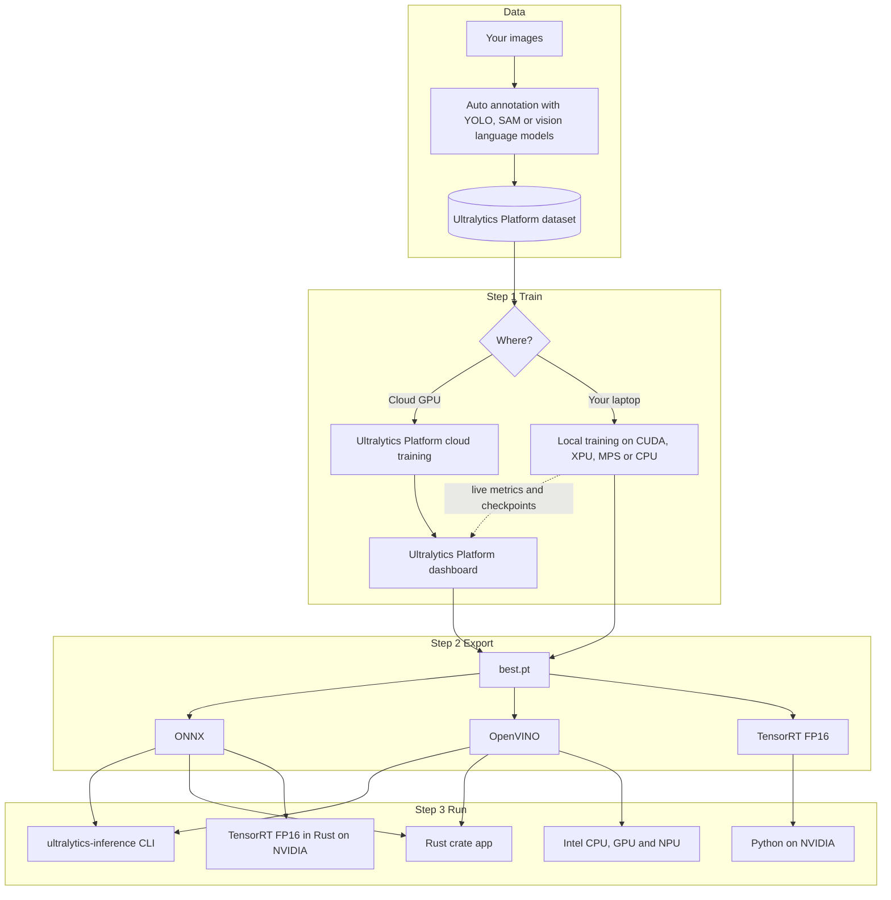

<div class="hero" markdown>

<div class="logos">
  
  
  
  
</div>

<h1><span class="b">No</span> <span class="r">GPU</span> <span class="y">Left</span> <span class="g">Behind</span></h1>

<p class="tagline">Hybrid Ultralytics YOLO training and fast execution on any laptop, from the cloud to Rust in 60 minutes</p>

[:simple-googlecolab: Open in Colab](https://colab.research.google.com/github/onuralpszr/gdg-samsun-etkinlik-2026-workshop/blob/main/notebooks/hybrid_yolo_workshop.ipynb){ .md-button .md-button--primary }
[:fontawesome-brands-github: Get the code](https://github.com/onuralpszr/gdg-samsun-etkinlik-2026-workshop){ .md-button }
[:material-rocket-launch: Ultralytics Platform](https://platform.ultralytics.com){ .md-button }

</div>

## What we build today :sparkles:

You do not need a giant GPU to do serious computer vision. Today we train an Ultralytics YOLO model on whatever you brought (an NVIDIA card, an Intel laptop with Arc graphics and an NPU, a MacBook or a plain CPU), stream the run to the **Ultralytics Platform**, export it to **ONNX**, **OpenVINO** and **TensorRT**, and finally ship it as a tiny Rust binary with **Ultralytics Inference**.

<div class="steps" markdown>
<div class="card" markdown>
<strong>:key: Step 0 Setup</strong>
One script builds a `.venv` with the right PyTorch for your hardware plus OpenVINO and checks every accelerator you have.
</div>
<div class="card" markdown>
<strong>:weight_lifter: Step 1 Train</strong>
Train `yolo26n.pt` locally while the Ultralytics Platform shows live metrics, or click once to train on a cloud GPU.
</div>
<div class="card" markdown>
<strong>:package: Step 2 Export</strong>
Export to ONNX, OpenVINO and TensorRT, then race every format on every device you own.
</div>
<div class="card" markdown>
<strong>:crab: Step 3 Ship</strong>
Run the same model from the `ultralytics-inference` CLI and Rust crate with flat memory and no Python at all.
</div>
</div>

## Agenda for the hour :alarm_clock:

| Time | Block | What happens |
|---|---|---|
| 00:00 | Warm up | Who has a GPU? Who has an NPU? Hands up, nobody gets left behind |
| 00:05 | Step 0 | Run the prerequisites check and log in to the Ultralytics Platform |
| 00:12 | Step 1 | Hybrid training on your laptop with live Platform metrics, plus a cloud training tour |
| 00:25 | Playground | Seven tasks, tracking, Solutions and auto annotation in a few lines each |
| 00:35 | Step 2 | Export to ONNX, OpenVINO and TensorRT and run the great speed race |
| 00:45 | Step 3 | Ultralytics Inference in Rust, the CLI, batch, video and webcam |
| 00:55 | Wrap up | Live webcam showdown, follow up links and questions |

## Architecture :world_map:



## Step 0: Prerequisites check :white_check_mark:

=== "Linux and macOS"

    ```bash
    git clone https://github.com/onuralpszr/gdg-samsun-etkinlik-2026-workshop.git
    cd gdg-samsun-etkinlik-2026-workshop
    ./setup_env.sh          # Intel GPU and NPU laptops (PyTorch XPU plus OpenVINO)
    ./setup_env.sh cuda     # NVIDIA machines
    ./setup_env.sh cpu      # Apple silicon (MPS) and any other machine
    source .venv/bin/activate
    ```

=== "Windows PowerShell"

    ```powershell
    git clone https://github.com/onuralpszr/gdg-samsun-etkinlik-2026-workshop.git
    cd gdg-samsun-etkinlik-2026-workshop
    uv venv --python 3.13 .venv
    .venv\Scripts\activate
    uv pip install torch torchvision --index-url https://download.pytorch.org/whl/xpu   # or whl/cu130 for NVIDIA, whl/cpu for CPU only
    uv pip install -r requirements.txt
    python local_python/00_check_env.py
    ```

=== "Google Colab"

    Press **Open in Colab** at the top of this page and pick **Runtime > Change runtime type > T4 GPU**. Nothing to install on your laptop.

The check lists PyTorch and every accelerator it can find, from NVIDIA CUDA, Intel XPU and Apple MPS to the OpenVINO CPU, GPU and NPU devices. It also checks ONNX Runtime, Rust and your Ultralytics Platform key, then recommends the best training and inference device for your machine.

!!! tip "Checklist before we start"

    - [x] Python 3.11 or newer (the Ultralytics Platform integration needs it)
    - [x] `ultralytics` 8.4.120 or newer
    - [x] An Ultralytics Platform account and API key
    - [x] Rust 1.92 or newer for Step 3 (`curl https://sh.rustup.rs -sSf | sh`)
    - [x] FFmpeg development libraries if you want video and webcam in Rust

## Step 1: Ultralytics Platform and hybrid training :weight_lifter:

### 1.1 Get your API key

1. Sign up at [platform.ultralytics.com](https://platform.ultralytics.com). New accounts get free credits.
2. Open **Settings > API Keys** and create a key with the training scope. Copy it right away, it is shown once.
3. Log in from your terminal. The key is saved in your Ultralytics settings.

```bash
yolo login ul_your_api_key
# or for one shell session
export ULTRALYTICS_API_KEY=ul_your_api_key
```

### 1.2 Train locally, watch it in the cloud

The magic switch is `project="username/project"`. Training runs on **your** hardware and the Ultralytics Platform receives live metrics, plots, console output and the final checkpoint.

=== "Workshop script"

    ```bash
    python local_python/01_hybrid_train.py --model yolo26n.pt --data coco8.yaml --epochs 10 --project gdg-samsun
    ```

    The script validates your key, finds your username, turns `gdg-samsun` into `username/gdg-samsun` and picks the best device on its own (NVIDIA CUDA, Intel XPU, Apple MPS or CPU). No key? It trains offline and tells you where to get one.

=== "Python"

    ```python
    from ultralytics import YOLO

    model = YOLO("yolo26n.pt")
    # device: 0 for NVIDIA CUDA, "xpu" for Intel GPU, "mps" for Apple silicon, "cpu" for any machine
    model.train(data="coco8.yaml", epochs=10, device=0, project="your_username/gdg-samsun", name="laptop-run")
    ```

=== "CLI"

    ```bash
    # device=0 for NVIDIA CUDA, device=xpu for Intel GPU, device=mps for Apple silicon, device=cpu for any machine
    yolo train model=yolo26n.pt data=coco8.yaml epochs=10 device=0 project=your_username/gdg-samsun name=laptop-run
    ```

=== "Platform dataset"

    ```bash
    yolo train model=yolo26n.pt data=ul://your_username/datasets/your_dataset epochs=50 project=your_username/gdg-samsun
    ```

Ten epochs of `yolo26n.pt` on `coco8.yaml` take about **18 seconds** on a laptop GPU and reach **mAP50 0.941**.

<div class="gallery" markdown>
<figure markdown>

<figcaption>Loss and mAP curves during training</figcaption>
</figure>
<figure markdown>

<figcaption>A training batch with mosaic augmentation</figcaption>
</figure>
<figure markdown>

<figcaption>Validation predictions after 10 epochs</figcaption>
</figure>
</div>

### 1.3 Or train on a cloud GPU with one click

1. Open your project on the Ultralytics Platform and click **New Model**.
2. Pick `YOLO26n` under **Official**, pick a dataset in `ready` status.
3. Set epochs, batch and image size, then choose a GPU. The RTX 2000 Ada is perfect for a quick test.
4. Press **Start Training** and watch the same dashboard fill up.

Check what is free right now from Python, no key needed:

```bash
python local_python/08_platform_tour.py status     # live cloud GPU availability
python local_python/08_platform_tour.py whoami     # plan, credits and counts
python local_python/08_platform_tour.py projects   # your projects and models
python local_python/08_platform_tour.py predict --model your_username/gdg-samsun/laptop-run --image bus.jpg
```

## Playground: everything Ultralytics YOLO can do :art:

[](https://github.com/ultralytics/ultralytics/actions/workflows/ci.yml)
[](https://pypi.org/project/ultralytics/)
[](https://clickpy.clickhouse.com/dashboard/ultralytics)
[](https://pypi.org/project/ultralytics/)
[](https://discord.com/invite/ultralytics)
[](https://community.ultralytics.com)
[](https://www.reddit.com/r/ultralytics/)
[](https://colab.research.google.com/github/ultralytics/ultralytics/blob/main/examples/tutorial.ipynb)
[](https://www.kaggle.com/models/ultralytics/yolo26)

### Seven tasks, one API

```bash
python local_python/03_all_tasks.py
```

```python
from ultralytics import YOLO

YOLO("yolo26n-pose.pt").predict("https://ultralytics.com/images/zidane.jpg", save=True)
```

<div class="gallery" markdown>
<figure markdown>

<figcaption>detect with <code>yolo26n.pt</code></figcaption>
</figure>
<figure markdown>

<figcaption>segment with <code>yolo26n-seg.pt</code></figcaption>
</figure>
<figure markdown>

<figcaption>semantic with <code>yolo26n-sem.pt</code></figcaption>
</figure>
<figure markdown>

<figcaption>depth with <code>yolo26n-depth.pt</code></figcaption>
</figure>
<figure markdown>

<figcaption>classify with <code>yolo26n-cls.pt</code> (minibus 0.52)</figcaption>
</figure>
<figure markdown>

<figcaption>pose with <code>yolo26n-pose.pt</code></figcaption>
</figure>
<figure markdown>

<figcaption>obb with <code>yolo26n-obb.pt</code> (167 ships, 5 harbors)</figcaption>
</figure>
</div>

### Tracking

Every person keeps the same ID across frames. Pick from six trackers (`botsort`, `bytetrack`, `ocsort`, `deepocsort`, `fasttrack` and `tracktrack`) with any detect, segment, pose or obb model and with exported formats too.

```bash
python local_python/04_track.py --model yolo26n_openvino_model --device intel:gpu
python local_python/04_track.py --source 0 --show                     # your webcam
```

<div class="wide" markdown>

</div>

### Real world use cases with Solutions

```bash
python local_python/06_solutions.py --solution count     # people crossing a line
python local_python/06_solutions.py --solution heatmap   # where people spend time
python local_python/06_solutions.py --solution blur      # privacy blur
python local_python/06_solutions.py --solution speed     # speed estimation
```

<div class="wide" markdown>

</div>

### Automatic annotation

Labeling by hand is slow. On your own machine, Ultralytics YOLO finds the objects and SAM draws the masks, so you get YOLO segmentation labels for free.

The Ultralytics Platform goes further with **Smart Annotation** right in the browser. Click objects with SAM 3.1, run pretrained or your own fine tuned Ultralytics YOLO models, or type the class names and let a vision language model label the whole dataset. Pick one of the eight hosted open source models (Moondream 3.1 by default) or add your own provider key to use vision models from OpenAI, Anthropic, Google and more.

```bash
python local_python/07_auto_annotate.py
python local_python/07_auto_annotate.py --images path/to/your/images --classes 0 2
```

<div class="gallery" markdown>
<figure markdown>

<figcaption>5 polygons, zero clicks</figcaption>
</figure>
<figure markdown>

<figcaption>Even the tie gets a mask</figcaption>
</figure>
</div>

### Live webcam

The crowd favorite. Point the camera at the room and switch engines live.

```bash
python local_python/05_webcam.py                                              # best device on this machine
python local_python/05_webcam.py --model yolo26n_openvino_model --device intel:gpu
python local_python/05_webcam.py --model yolo26n-pose.pt --track
```

## Step 2: Export and the great speed race :package:

```bash
python local_python/02_export_model.py                      # yolo26n.pt to ONNX and OpenVINO, then race
python local_python/02_export_model.py --weights runs/detect/gdg-samsun/laptop-run/weights/best.pt
python local_python/02_export_model.py --tensorrt           # adds a TensorRT FP16 engine on NVIDIA
```

```python
from ultralytics import YOLO

model = YOLO("yolo26n.pt")
model.export(format="onnx", simplify=True)  # runs everywhere
model.export(format="openvino")  # Intel CPU, GPU and NPU
model.export(format="engine", half=True)  # NVIDIA TensorRT FP16

YOLO("yolo26n_openvino_model").predict("bus.jpg", device="intel:npu")  # yes, the NPU
```

### Results on the workshop laptop

Intel Core Ultra X7 358H with Arc B390 graphics and the built in NPU, `yolo26n.pt` at 640, median of 100 runs on `bus.jpg`.

| Format | Device | Size (MB) | Inference (ms) | End to end (ms) | FPS | Speedup | Objects |
|---|---|---:|---:|---:|---:|---:|---:|
| PyTorch | cpu | 5.5 | 14.6 | 15.7 | 69 | 1.0x | 5 |
| PyTorch | xpu | 5.5 | 3.2 | 5.3 | 312 | 4.6x | 5 |
| ONNX | cpu | 9.9 | 42.4 | 83.6 | 24 | 0.3x | 5 |
| OpenVINO | intel:cpu | 10.1 | 15.2 | 16.7 | 66 | 1.0x | 5 |
| OpenVINO | intel:gpu | 10.1 | 1.9 | 3.0 | 532 | 7.8x | 5 |
| OpenVINO | intel:npu | 10.1 | 3.2 | 4.7 | 316 | 4.6x | 5 |

!!! success "Takeaway"

    OpenVINO on the integrated Arc GPU is **7.8x faster** than PyTorch on the CPU. The NPU keeps up with PyTorch on the laptop GPU while sipping power, which makes it perfect for always on cameras. Same model, same accuracy, every box agrees.

!!! info "Got an NVIDIA GPU?"

    Add `--tensorrt` and the race gets a TensorRT FP16 row. On Colab pick the T4 runtime and the notebook does it for you. Rust can run TensorRT FP16 straight from the ONNX file too, see Step 3.4.

## Step 3: High speed execution with Ultralytics Inference :crab:

[](https://crates.io/crates/ultralytics-inference)
[](https://docs.rs/ultralytics-inference)
[](https://crates.io/crates/ultralytics-inference)
[](https://crates.io/crates/ultralytics-inference)
[](https://github.com/ultralytics/inference/actions/workflows/ci.yml)
[](https://app.codecov.io/github/ultralytics/inference)
[](https://github.com/ultralytics/inference/blob/main/LICENSE)
[](https://deps.rs/repo/github/ultralytics/inference)
[](https://arxiv.org/abs/2606.03748)
[](https://discord.com/invite/ultralytics)

Ultralytics Inference is a Rust library and CLI for Ultralytics YOLO. It reads ONNX and OpenVINO exports, handles all seven tasks, and runs on CPU, CUDA, TensorRT, CoreML, OpenVINO and more. One small binary, no Python at runtime.

### 3.1 The CLI

```bash
cargo install ultralytics-inference --features "openvino-native,video"

# OpenVINO native needs to find the runtime, the pip package works fine
export LD_LIBRARY_PATH=$(python -c "import openvino, os; print(os.path.dirname(openvino.__file__))")/libs

ultralytics-inference predict --model yolo26n.onnx --source bus.jpg                         # single image
ultralytics-inference predict --model yolo26n.onnx --source images/ --batch 4               # a folder
ultralytics-inference predict --model yolo26n_openvino_model --device intel:gpu --source video.mp4
ultralytics-inference predict --model yolo26n_openvino_model --device intel:npu --source 0 --show
ultralytics-inference predict --task pose                                                    # any task, model auto downloads
```

Or let the workshop script drive it:

```bash
./local_inference/run_cli.sh all          # image, batch, video, all tasks, Intel devices and the Rust app
CAMERA=50 ./local_inference/run_cli.sh webcam
```

### 3.2 The crate in your own app

`local_inference/` is a complete Cargo project with four modes in about 200 lines.

```toml
[dependencies]
ultralytics-inference = { version = "0.0.54", features = ["openvino-native", "video"] }
```

```rust
use ultralytics_inference::{Device, InferenceConfig, Source, SourceIterator, YOLOModel};

fn main() -> Result<(), Box<dyn std::error::Error>> {
    let config = InferenceConfig::new().with_confidence(0.25).with_device(Device::IntelGpu);
    let mut model = YOLOModel::load_with_config("yolo26n_openvino_model", config)?;

    // One frame in memory at a time, so a 10 hour stream costs the same RAM as a 10 second clip
    for item in SourceIterator::new(Source::from("video.mp4"))? {
        let (frame, meta) = item?;
        for result in model.predict_image(&frame, meta.path)? {
            println!("{}", result.detection_summary());
        }
    }
    Ok(())
}
```

```bash
cargo build --release --manifest-path local_inference/Cargo.toml --features "openvino,video"
BIN=local_inference/target/release/gdg-inference
$BIN image yolo26n.onnx bus.jpg                                       # single image
$BIN batch yolo26n.onnx datasets/coco8/images/val 4                    # folder in batches
DEVICE=intel:gpu $BIN video yolo26n_openvino_model video.mp4           # video, webcam or RTSP
DEVICE=intel:npu $BIN bench yolo26n_openvino_model bus.jpg 300         # latency
```

### 3.3 All seven tasks in Rust

Pass `--task` and the CLI downloads the matching YOLO26 nano model, runs it on the sample images and saves the annotated results under `runs/<task>/`. Every picture below was drawn by the Rust CLI on the workshop laptop, with no Python involved.

```bash
./local_inference/run_cli.sh tasks                                    # all seven tasks in one go
ultralytics-inference predict --task segment --source bus.jpg         # one task on your own image
```

<div class="gallery" markdown>
<figure markdown>

<figcaption>detect, the same boxes as Python</figcaption>
</figure>
<figure markdown>

<figcaption>segment</figcaption>
</figure>
<figure markdown>

<figcaption>semantic</figcaption>
</figure>
<figure markdown>

<figcaption>depth</figcaption>
</figure>
<figure markdown>

<figcaption>classify (minibus 0.53)</figcaption>
</figure>
<figure markdown>

<figcaption>pose</figcaption>
</figure>
<figure markdown>

<figcaption>obb, every ship and harbor in the port</figcaption>
</figure>
</div>

### 3.4 NVIDIA TensorRT FP16 straight from ONNX

You do not need the `.engine` file from Step 2 to use TensorRT in Rust. Ultralytics Inference hands the ONNX model to the ONNX Runtime TensorRT execution provider, which builds an FP16 engine on the first run and caches it in `.trt_cache/` next to the model. The first load takes about a minute, and every load after that starts in seconds.

```bash
cargo install ultralytics-inference --features "nvidia,video"
ultralytics-inference predict --model yolo26n.onnx --source bus.jpg --device tensorrt:0 --quantize 16

cargo build --release --manifest-path local_inference/Cargo.toml --features "nvidia,video"
DEVICE=tensorrt:0 local_inference/target/release/gdg-inference bench yolo26n.onnx bus.jpg 300   # FP16 by default
```

```rust
let config = InferenceConfig::new().with_device(Device::TensorRt(0)).with_quantize(Quantization::Fp16);
let mut model = YOLOModel::load_with_config("yolo26n.onnx", config)?;
```

!!! info "What TensorRT needs"

    An NVIDIA driver plus the CUDA 13 runtime, cuDNN 9 and TensorRT 10 on the library path. The prebuilt ONNX Runtime is built for CUDA 13 only. Pass `--rect false` to the CLI so every frame has the same shape and only one engine gets built. Want plain CUDA without TensorRT? Use `--device cuda:0`.

### Results: Python vs Rust

Same laptop, same `yolo26n` exports, best of three medians over 300 runs.

| Engine | Device | Inference (ms) | End to end (ms) | FPS |
|---|---|---:|---:|---:|
| ONNX Runtime | cpu | 15.65 | 16.33 | 61 |
| OpenVINO | intel:cpu | 24.63 | 25.30 | 40 |
| OpenVINO with THREADS=16 | intel:cpu | 15.04 | 15.80 | 63 |
| OpenVINO | intel:gpu | 1.91 | 2.40 | 417 |
| OpenVINO | intel:npu | 2.19 | 2.73 | 366 |

Video throughput and memory on a 620 frame crowd clip:

| Runtime | Engine and device | Frames | FPS | Peak memory |
|---|---|---:|---:|---:|
| Python Ultralytics YOLO `predict(stream=True)` | OpenVINO on intel:gpu | 620 | 283 | 942 MB |
| Rust `gdg-inference video` (Ultralytics Inference crate) | OpenVINO on intel:gpu | 620 | 400 | 284 MB |

!!! success "Takeaway"

    The Rust binary is **37 MB** and needs no Python environment (the workshop Python `.venv` is 7.9 GB). End to end it beats Python on the GPU, the NPU and ONNX Runtime, matches it on the CPU once threads are set, runs video **1.4x faster** and uses **3.3x less memory**. ONNX Runtime on the CPU goes from 83.6 ms in Python to 16.3 ms in Rust.

!!! tip "Hybrid laptops and CPU threads"

    On Intel hybrid CPUs, OpenVINO in Rust picks its own thread count by default. Pass `THREADS=16` (all cores) to the workshop app or call `.with_threads(16)` and the CPU path gets about 1.6x faster.

## Mini challenges :trophy:

- [ ] Make the NPU count people walking past the camera with `06_solutions.py --solution count --model yolo26n_openvino_model --device intel:npu`
- [ ] Find the fastest device on your own laptop with `02_export_model.py` and share the table
- [ ] Auto annotate ten photos from your phone and upload them as a dataset on the Ultralytics Platform
- [ ] Track your friends with `yolo26n-pose.pt` and `--track` on the webcam
- [ ] Build the Rust app and beat the Python FPS on your machine

## Troubleshooting :wrench:

??? question "Webcam index 0 does not open"

    Many new laptops expose the camera through an Intel IPU with a v4l2loopback device. List devices with `v4l2-ctl --list-devices` and use the loopback index, for example `--camera 50` in Python or `CAMERA=50` for `run_cli.sh`.

??? question "OpenVINO does not list intel:gpu or intel:npu"

    Run `python -c "import openvino as ov; print(ov.Core().available_devices)"`. If GPU or NPU is not in the list, install the Intel GPU compute runtime and the NPU driver for your distro and reboot.

??? question "The Rust CLI cannot find libopenvino_c"

    Export `LD_LIBRARY_PATH` to the `libs` folder of the `openvino` pip package as shown in Step 3.1. `run_cli.sh` does it for you.

??? question "PyTorch does not see my GPU"

    Run `python local_python/00_check_env.py` to see what PyTorch finds. NVIDIA cards need the CUDA build from `./setup_env.sh cuda` and a recent driver. Intel GPUs need the XPU build from `./setup_env.sh` and an up to date Intel GPU driver. Apple silicon gets MPS from the `./setup_env.sh cpu` build.

??? question "Training does not show up on the Ultralytics Platform"

    You need Python 3.11 or newer, `ultralytics` 8.4.120 or newer, a valid key from `yolo login`, and a `project` in the `username/project` form.

## Repository map :file_folder:

| Path | What it is |
|---|---|
| `setup_env.sh` | Builds `.venv` with PyTorch for CUDA, Intel XPU or CPU plus OpenVINO |
| `local_python/00_check_env.py` | Prerequisites check for every accelerator |
| `local_python/01_hybrid_train.py` | Ultralytics Platform login and hybrid training |
| `local_python/02_export_model.py` | ONNX, OpenVINO and TensorRT export plus the speed race |
| `local_python/03_all_tasks.py` | detect, segment, semantic, depth, classify, pose and obb |
| `local_python/04_track.py` | Multi object tracking on video or webcam |
| `local_python/05_webcam.py` | Live webcam with an FPS counter |
| `local_python/06_solutions.py` | Counting, heatmap, privacy blur and speed estimation |
| `local_python/07_auto_annotate.py` | Auto annotation with Ultralytics YOLO and SAM |
| `local_python/08_platform_tour.py` | Ultralytics Platform Python client tour |
| `local_python/device_utils.py` | Shared device picker for NVIDIA CUDA, Intel XPU, Apple MPS and CPU |
| `local_inference/` | Rust Cargo project plus `run_cli.sh` for `ultralytics-inference` |
| `notebooks/hybrid_yolo_workshop.ipynb` | The whole workshop in Google Colab |
| `tools/` | Notebook generator and prose style checker |

## Stay in touch :handshake:

<div class="qr" markdown>
<div markdown>


**This workshop page**
</div>
<div markdown>


**Join the Ultralytics Platform**
</div>
</div>

- :rocket: [Ultralytics Platform](https://platform.ultralytics.com) and its [docs](https://docs.ultralytics.com/platform/)
- :crab: [Ultralytics Inference on GitHub](https://github.com/ultralytics/inference) and [crates.io](https://crates.io/crates/ultralytics-inference)
- :books: [Ultralytics YOLO docs](https://docs.ultralytics.com)
- :speech_balloon: [Ultralytics Discord](https://discord.com/invite/ultralytics)

No GPU was left behind today. Teşekkürler Samsun! :tada:
