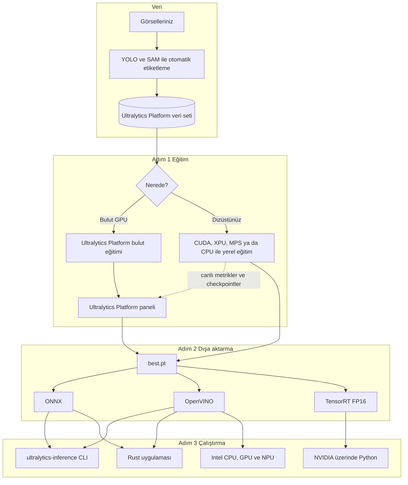
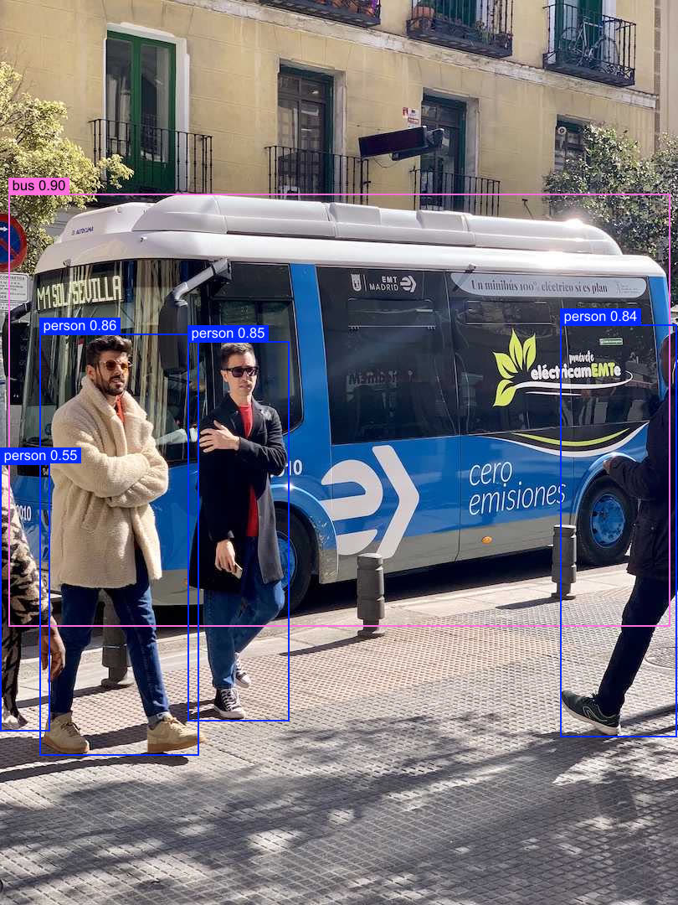

<div class="hero" markdown>

<div class="logos">
  
  
  
  
</div>

<h1><span class="b">Hiçbir</span> <span class="r">GPU</span> <span class="y">Geride</span> <span class="g">Kalmasın</span></h1>

<p class="tagline">Her dizüstü bilgisayarda hibrit Ultralytics YOLO eğitimi ve hızlı çalıştırma, buluttan Rust'a 60 dakikada</p>

[:simple-googlecolab: Colab'da aç](https://colab.research.google.com/github/onuralpszr/gdg-samsun-etkinlik-2026-workshop/blob/main/notebooks/hybrid_yolo_workshop.ipynb){ .md-button .md-button--primary }
[:fontawesome-brands-github: Kodu al](https://github.com/onuralpszr/gdg-samsun-etkinlik-2026-workshop){ .md-button }
[:material-rocket-launch: Ultralytics Platform](https://platform.ultralytics.com){ .md-button }

</div>

## Bugün ne yapıyoruz :sparkles:

Ciddi bilgisayarlı görü işleri için dev bir GPU'ya ihtiyacınız yok. Bugün yanınızda ne varsa (bir NVIDIA kartı, Arc grafikli ve NPU'lu bir Intel dizüstü, bir MacBook ya da sadece CPU) onunla bir Ultralytics YOLO modeli eğitiyoruz, eğitimi canlı olarak **Ultralytics Platform**'a aktarıyoruz, modeli **ONNX**, **OpenVINO** ve **TensorRT** formatlarına dönüştürüyoruz ve sonunda **Ultralytics Inference** ile küçücük bir Rust programı olarak yayınlıyoruz.

<div class="steps" markdown>
<div class="card" markdown>
<strong>:key: Adım 0 Kurulum</strong>
Tek bir betik PyTorch XPU, CUDA ya da CPU ile OpenVINO içeren bir `.venv` kurar ve sahip olduğunuz her hızlandırıcıyı kontrol eder.
</div>
<div class="card" markdown>
<strong>:weight_lifter: Adım 1 Eğitim</strong>
`yolo26n.pt` modelini kendi bilgisayarınızda eğitin, Ultralytics Platform metrikleri canlı göstersin. Ya da tek tıkla bulut GPU'sunda eğitin.
</div>
<div class="card" markdown>
<strong>:package: Adım 2 Dışa aktarma</strong>
ONNX, OpenVINO ve TensorRT formatlarına aktarın, sonra her formatı sahip olduğunuz her cihazda yarıştırın.
</div>
<div class="card" markdown>
<strong>:crab: Adım 3 Yayına alma</strong>
Aynı modeli `ultralytics-inference` CLI ve Rust kütüphanesi ile sabit bellekle ve hiç Python olmadan çalıştırın.
</div>
</div>

## Bir saatlik program :alarm_clock:

| Saat | Bölüm | Neler oluyor |
|---|---|---|
| 00:00 | Isınma | Kimde GPU var? Kimde NPU var? Eller havaya, kimse geride kalmıyor |
| 00:05 | Adım 0 | Ön koşul kontrolünü çalıştırın ve Ultralytics Platform'a giriş yapın |
| 00:12 | Adım 1 | Canlı Platform metrikleriyle dizüstünde hibrit eğitim ve bulut eğitimi turu |
| 00:25 | Oyun alanı | Yedi görev, takip, Solutions ve otomatik etiketleme, her biri birkaç satır |
| 00:35 | Adım 2 | ONNX, OpenVINO ve TensorRT'ye aktarma ve büyük hız yarışı |
| 00:45 | Adım 3 | Rust ile Ultralytics Inference, CLI, toplu işleme, video ve webcam |
| 00:55 | Kapanış | Canlı webcam karşılaşması, takip bağlantıları ve sorular |

## Mimari :world_map:



## Adım 0: Ön koşul kontrolü :white_check_mark:

=== "Linux ve macOS"

    ```bash
    git clone https://github.com/onuralpszr/gdg-samsun-etkinlik-2026-workshop.git
    cd gdg-samsun-etkinlik-2026-workshop
    ./setup_env.sh          # Intel GPU ve NPU'lu dizüstüler (PyTorch XPU ve OpenVINO)
    ./setup_env.sh cuda     # NVIDIA makineler
    ./setup_env.sh cpu      # diğer her şey
    source .venv/bin/activate
    ```

=== "Windows PowerShell"

    ```powershell
    git clone https://github.com/onuralpszr/gdg-samsun-etkinlik-2026-workshop.git
    cd gdg-samsun-etkinlik-2026-workshop
    uv venv --python 3.13 .venv
    .venv\Scripts\activate
    uv pip install torch torchvision --index-url https://download.pytorch.org/whl/xpu
    uv pip install -r requirements.txt
    python local_python/00_check_env.py
    ```

=== "Google Colab"

    Sayfanın üstündeki **Colab'da aç** düğmesine basın ve **Runtime > Change runtime type > T4 GPU** seçin. Dizüstünüze hiçbir şey kurmanız gerekmez.

Kontrol betiği bulabildiği her hızlandırıcıyı listeler. Atölye dizüstünün giriş yapmadan önceki çıktısı:

```text
[OK  ] Python                       3.13.16
[OK  ] PyTorch                      2.14.1+xpu
[MISS] NVIDIA CUDA
[OK  ] Intel XPU (PyTorch)          Intel(R) Arc(TM) B390 GPU
[MISS] Apple MPS
[OK  ] Ultralytics YOLO             8.4.184
[OK  ] OpenVINO                     2026.4.1 devices: CPU, GPU, NPU
[OK  ] Intel NPU (OpenVINO)         ready for intel:npu
[OK  ] ONNX Runtime                 1.31.0 providers: AzureExecutionProvider, CPUExecutionProvider
[OK  ] Rust cargo                   needed for Step 3
[OK  ] ultralytics-inference CLI    cargo install ultralytics-inference
[MISS] Ultralytics Platform key     run: yolo login YOUR_API_KEY

Recommended training device: --device xpu
Recommended fast inference: OpenVINO on intel:gpu or intel:npu when you have Intel silicon
```

Son satırdaki `MISS`, Adım 1.1'i bitirdiğiniz anda `OK` olur.

!!! tip "Başlamadan önce kontrol listesi"

    - [x] Python 3.11 ya da daha yenisi (Ultralytics Platform entegrasyonu bunu istiyor)
    - [x] `ultralytics` 8.4.120 ya da daha yenisi
    - [x] Bir Ultralytics Platform hesabı ve API anahtarı
    - [x] Adım 3 için Rust 1.92 ya da daha yenisi (`curl https://sh.rustup.rs -sSf | sh`)
    - [x] Rust ile video ve webcam kullanmak isterseniz FFmpeg geliştirme kütüphaneleri

## Adım 1: Ultralytics Platform ve hibrit eğitim :weight_lifter:

### 1.1 API anahtarınızı alın

1. [platform.ultralytics.com](https://platform.ultralytics.com) adresinden kaydolun. Yeni hesaplara ücretsiz kredi verilir.
2. **Settings > API Keys** sayfasını açın ve eğitim yetkisi olan bir anahtar oluşturun. Hemen kopyalayın, sadece bir kez gösterilir.
3. Terminalden giriş yapın. Anahtar Ultralytics ayarlarınıza kaydedilir.

```bash
yolo login ul_your_api_key
# ya da sadece bu terminal oturumu için
export ULTRALYTICS_API_KEY=ul_your_api_key
```

### 1.2 Yerelde eğitin, bulutta izleyin

Sihirli anahtar `project="username/project"`. Eğitim **sizin** donanımınızda çalışır, Ultralytics Platform ise canlı metrikleri, grafikleri, konsol çıktısını ve son checkpoint dosyasını alır.

=== "Atölye betiği"

    ```bash
    python local_python/01_hybrid_train.py --model yolo26n.pt --data coco8.yaml --epochs 10 --device xpu --project gdg-samsun
    ```

    Betik anahtarınızı doğrular, kullanıcı adınızı bulur, `gdg-samsun` adını `username/gdg-samsun` yapar ve `--device auto` verdiğinizde en iyi cihazı seçer. Anahtarınız yok mu? Çevrimdışı eğitir ve nereden anahtar alacağınızı söyler.

=== "Python"

    ```python
    from ultralytics import YOLO

    model = YOLO("yolo26n.pt")
    model.train(data="coco8.yaml", epochs=10, device="xpu", project="your_username/gdg-samsun", name="laptop-run")
    ```

=== "CLI"

    ```bash
    yolo train model=yolo26n.pt data=coco8.yaml epochs=10 device=xpu project=your_username/gdg-samsun name=laptop-run
    ```

=== "Platform veri seti"

    ```bash
    yolo train model=yolo26n.pt data=ul://your_username/datasets/your_dataset epochs=50 project=your_username/gdg-samsun
    ```

`yolo26n.pt` modelinin `coco8.yaml` üzerinde on epoch eğitimi, Intel Arc B390 dizüstü GPU'sunda PyTorch XPU ile **18 saniye** sürüyor ve **mAP50 0.941** değerine ulaşıyor.

<div class="gallery" markdown>
<figure markdown>

<figcaption>XPU eğitiminin kayıp ve mAP eğrileri</figcaption>
</figure>
<figure markdown>

<figcaption>Mozaik veri artırmalı bir eğitim grubu</figcaption>
</figure>
<figure markdown>

<figcaption>10 epoch sonrası doğrulama tahminleri</figcaption>
</figure>
</div>

### 1.3 Ya da tek tıkla bulut GPU'sunda eğitin

1. Ultralytics Platform'da projenizi açın ve **New Model** düğmesine tıklayın.
2. **Official** altından `YOLO26n` seçin, durumu `ready` olan bir veri seti seçin.
3. Epoch, batch ve görsel boyutunu ayarlayın, sonra bir GPU seçin. Hızlı bir deneme için RTX 2000 Ada ideal.
4. **Start Training** düğmesine basın ve aynı panelin dolmasını izleyin.

Şu an hangi GPU'ların boşta olduğunu Python'dan kontrol edin, anahtar gerekmez:

```bash
python local_python/08_platform_tour.py status     # canlı bulut GPU durumu
python local_python/08_platform_tour.py whoami     # plan, kredi ve sayılar
python local_python/08_platform_tour.py projects   # projeleriniz ve modelleriniz
python local_python/08_platform_tour.py predict --model your_username/gdg-samsun/laptop-run --image bus.jpg
```

## Oyun alanı: Ultralytics YOLO'nun yapabildiği her şey :art:

### Yedi görev, tek API

```bash
python local_python/03_all_tasks.py --device xpu
```

```python
from ultralytics import YOLO

YOLO("yolo26n-pose.pt").predict("https://ultralytics.com/images/zidane.jpg", save=True)
```

<div class="gallery" markdown>
<figure markdown>

<figcaption>detect, <code>yolo26n.pt</code> ile</figcaption>
</figure>
<figure markdown>

<figcaption>segment, <code>yolo26n-seg.pt</code> ile</figcaption>
</figure>
<figure markdown>

<figcaption>semantic, <code>yolo26n-sem.pt</code> ile</figcaption>
</figure>
<figure markdown>

<figcaption>depth, <code>yolo26n-depth.pt</code> ile</figcaption>
</figure>
<figure markdown>

<figcaption>classify, <code>yolo26n-cls.pt</code> ile (minibus 0.52)</figcaption>
</figure>
<figure markdown>

<figcaption>pose, <code>yolo26n-pose.pt</code> ile</figcaption>
</figure>
<figure markdown>

<figcaption>obb, <code>yolo26n-obb.pt</code> ile (167 gemi, 5 liman)</figcaption>
</figure>
</div>

### Takip

Her kişi kareler boyunca aynı ID'yi korur. Altı takipçiden birini seçin (`botsort`, `bytetrack`, `ocsort`, `deepocsort`, `fasttrack` ve `tracktrack`), detect, segment, pose ya da obb modelleriyle ve dışa aktarılmış formatlarla da çalışır.

```bash
python local_python/04_track.py --model yolo26n_openvino_model --device intel:gpu
python local_python/04_track.py --source 0 --show                     # webcam'iniz
```

<div class="wide" markdown>

</div>

### Solutions ile gerçek hayat senaryoları

```bash
python local_python/06_solutions.py --solution count     # çizgiyi geçen insanlar
python local_python/06_solutions.py --solution heatmap   # insanların vakit geçirdiği yerler
python local_python/06_solutions.py --solution blur      # gizlilik bulanıklaştırma
python local_python/06_solutions.py --solution speed     # hız tahmini
```

<div class="wide" markdown>

</div>

### Otomatik etiketleme

Elle etiketlemek yavaştır. Ultralytics YOLO nesneleri bulur, SAM maskeleri çizer ve YOLO segmentasyon etiketleri bedavaya gelir. İncelemek için Ultralytics Platform'a yükleyin ya da tarayıcıda doğrudan SAM 3.1 ile Platform **Smart Annotation** özelliğini kullanın.

```bash
python local_python/07_auto_annotate.py --device xpu
python local_python/07_auto_annotate.py --images path/to/your/images --classes 0 2
```

<div class="gallery" markdown>
<figure markdown>

<figcaption>5 poligon, sıfır tık</figcaption>
</figure>
<figure markdown>

<figcaption>Kravat bile maskesini alıyor</figcaption>
</figure>
</div>

### Canlı webcam

Salonun favorisi. Kamerayı salona çevirin ve motorları canlı değiştirin.

```bash
python local_python/05_webcam.py                                              # CPU üzerinde PyTorch
python local_python/05_webcam.py --model yolo26n_openvino_model --device intel:gpu
python local_python/05_webcam.py --model yolo26n-pose.pt --device xpu --track
```

## Adım 2: Dışa aktarma ve büyük hız yarışı :package:

```bash
python local_python/02_export_model.py                      # yolo26n.pt modelini ONNX ve OpenVINO'ya aktar, sonra yarıştır
python local_python/02_export_model.py --weights runs/detect/gdg-samsun/laptop-run/weights/best.pt
python local_python/02_export_model.py --tensorrt           # NVIDIA üzerinde TensorRT FP16 motoru ekler
```

```python
from ultralytics import YOLO

model = YOLO("yolo26n.pt")
model.export(format="onnx", simplify=True)  # her yerde çalışır
model.export(format="openvino")  # Intel CPU, GPU ve NPU
model.export(format="engine", half=True)  # NVIDIA TensorRT FP16

YOLO("yolo26n_openvino_model").predict("bus.jpg", device="intel:npu")  # evet, NPU üzerinde
```

### Atölye dizüstündeki sonuçlar

Arc B390 grafikli ve dahili NPU'lu Intel Core Ultra X7 358H, 640 boyutunda `yolo26n.pt`, `bus.jpg` üzerinde 100 çalıştırmanın medyanı.

| Format | Cihaz | Boyut (MB) | Çıkarım (ms) | Uçtan uca (ms) | FPS | Hızlanma | Nesne |
|---|---|---:|---:|---:|---:|---:|---:|
| PyTorch | cpu | 5.5 | 14.6 | 15.7 | 69 | 1.0x | 5 |
| PyTorch | xpu | 5.5 | 3.2 | 5.3 | 312 | 4.6x | 5 |
| ONNX | cpu | 9.9 | 42.4 | 83.6 | 24 | 0.3x | 5 |
| OpenVINO | intel:cpu | 10.1 | 15.2 | 16.7 | 66 | 1.0x | 5 |
| OpenVINO | intel:gpu | 10.1 | 1.9 | 3.0 | 532 | 7.8x | 5 |
| OpenVINO | intel:npu | 10.1 | 3.2 | 4.7 | 316 | 4.6x | 5 |

!!! success "Çıkarılacak ders"

    Dahili Arc GPU üzerinde OpenVINO, CPU üzerindeki PyTorch'tan **7.8 kat daha hızlı**. NPU çok az güç harcarken PyTorch XPU'ya yetişiyor, bu da onu sürekli açık kameralar için ideal yapıyor. Aynı model, aynı doğruluk, her kutu birebir aynı.

!!! info "NVIDIA GPU'nuz mu var?"

    `--tensorrt` ekleyin, yarışa bir TensorRT FP16 satırı gelsin. Colab'da T4 çalışma ortamını seçin, notebook bunu sizin için yapar.

## Adım 3: Ultralytics Inference ile yüksek hızda çalıştırma :crab:

Ultralytics Inference, Ultralytics YOLO için bir Rust kütüphanesi ve CLI aracıdır. ONNX ve OpenVINO çıktılarını okur, yedi görevin hepsini destekler ve CPU, CUDA, TensorRT, CoreML, OpenVINO ve daha fazlası üzerinde çalışır. Tek küçük bir program, çalışırken Python yok.

### 3.1 CLI

```bash
cargo install ultralytics-inference --features "openvino-native,video"

# OpenVINO native çalışma kütüphanesini bulmalı, pip paketi işi görür
export LD_LIBRARY_PATH=$(python -c "import openvino, os; print(os.path.dirname(openvino.__file__))")/libs

ultralytics-inference predict --model yolo26n.onnx --source bus.jpg                         # tek görsel
ultralytics-inference predict --model yolo26n.onnx --source images/ --batch 4               # bir klasör
ultralytics-inference predict --model yolo26n_openvino_model --device intel:gpu --source video.mp4
ultralytics-inference predict --model yolo26n_openvino_model --device intel:npu --source 0 --show
ultralytics-inference predict --task pose                                                    # her görev, model kendiliğinden iner
```

Ya da atölye betiği sizin yerinize çalıştırsın:

```bash
./local_inference/run_cli.sh all          # görsel, toplu, video, tüm görevler, Intel cihazlar ve Rust uygulaması
CAMERA=50 ./local_inference/run_cli.sh webcam
```

### 3.2 Kendi uygulamanızda kütüphane olarak

`local_inference/` yaklaşık 200 satırda dört modu olan eksiksiz bir Cargo projesidir.

```toml
[dependencies]
ultralytics-inference = { version = "0.0.54", features = ["openvino-native", "video"] }
```

```rust
use ultralytics_inference::{Device, InferenceConfig, Source, SourceIterator, YOLOModel};

fn main() -> Result<(), Box<dyn std::error::Error>> {
    let config = InferenceConfig::new().with_confidence(0.25).with_device(Device::IntelGpu);
    let mut model = YOLOModel::load_with_config("yolo26n_openvino_model", config)?;

    // Bellekte aynı anda tek kare, 10 saatlik bir yayın 10 saniyelik bir klip kadar RAM harcar
    for item in SourceIterator::new(Source::from("video.mp4"))? {
        let (frame, meta) = item?;
        for result in model.predict_image(&frame, meta.path)? {
            println!("{}", result.detection_summary());
        }
    }
    Ok(())
}
```

```bash
cargo build --release --manifest-path local_inference/Cargo.toml --features "openvino,video"
BIN=local_inference/target/release/gdg-inference
$BIN image yolo26n.onnx bus.jpg                                       # tek görsel
$BIN batch yolo26n.onnx datasets/coco8/images/val 4                    # klasörü gruplar halinde
DEVICE=intel:gpu $BIN video yolo26n_openvino_model video.mp4           # video, webcam ya da RTSP
DEVICE=intel:npu $BIN bench yolo26n_openvino_model bus.jpg 300         # gecikme ölçümü
```

<div class="gallery" markdown>
<figure markdown>

<figcaption>Rust programının çizdiği çıktı, Python ile aynı kutular</figcaption>
</figure>
</div>

### Sonuçlar: Python ve Rust

Aynı dizüstü, aynı `yolo26n` çıktıları, 300 çalıştırmanın medyanlarından üçünün en iyisi.

| Motor | Cihaz | Çıkarım (ms) | Uçtan uca (ms) | FPS |
|---|---|---:|---:|---:|
| ONNX Runtime | cpu | 15.65 | 16.33 | 61 |
| OpenVINO | intel:cpu | 24.63 | 25.30 | 40 |
| OpenVINO, THREADS=16 ile | intel:cpu | 15.04 | 15.80 | 63 |
| OpenVINO | intel:gpu | 1.91 | 2.40 | 417 |
| OpenVINO | intel:npu | 2.19 | 2.73 | 366 |

620 karelik bir kalabalık videosunda hız ve bellek:

| Çalışma ortamı | Motor ve cihaz | Kare | FPS | En yüksek bellek |
|---|---|---:|---:|---:|
| Python Ultralytics YOLO `predict(stream=True)` | intel:gpu üzerinde OpenVINO | 620 | 283 | 942 MB |
| Rust `gdg-inference video` (Ultralytics Inference kütüphanesi) | intel:gpu üzerinde OpenVINO | 620 | 400 | 284 MB |

!!! success "Çıkarılacak ders"

    Rust programı **37 MB** ve Python ortamına ihtiyaç duymuyor (PyTorch XPU içeren atölye `.venv` klasörü 7.9 GB). Uçtan uca ölçümde GPU, NPU ve ONNX Runtime üzerinde Python'u geçiyor, thread sayısı ayarlanınca CPU'da onunla başa baş gidiyor, videoyu **1.4 kat daha hızlı** işliyor ve **3.3 kat daha az bellek** kullanıyor. CPU üzerinde ONNX Runtime, Python'da 83.6 ms iken Rust'ta 16.3 ms.

!!! tip "Hibrit işlemciler ve CPU thread sayısı"

    Intel hibrit işlemcilerde Rust tarafındaki OpenVINO varsayılan olarak thread sayısını kendisi seçer. Atölye uygulamasına `THREADS=16` (tüm çekirdekler) verin ya da `.with_threads(16)` çağırın, CPU yolu yaklaşık 1.6 kat hızlanır.

## Mini görevler :trophy:

- [ ] `06_solutions.py --solution count --model yolo26n_openvino_model --device intel:npu` ile NPU'ya kameranın önünden geçen insanları saydırın
- [ ] `02_export_model.py` ile kendi dizüstünüzdeki en hızlı cihazı bulun ve tabloyu paylaşın
- [ ] Telefonunuzdan on fotoğrafı otomatik etiketleyin ve Ultralytics Platform'a veri seti olarak yükleyin
- [ ] Webcam'de `yolo26n-pose.pt` ve `--track` ile arkadaşlarınızı takip edin
- [ ] Rust uygulamasını derleyin ve kendi makinenizde Python FPS değerini geçin

## Sorun giderme :wrench:

??? question "Webcam 0 numarasıyla açılmıyor"

    Yeni dizüstülerin çoğu kamerayı bir Intel IPU ve v4l2loopback cihazı üzerinden sunar. `v4l2-ctl --list-devices` ile cihazları listeleyin ve loopback numarasını kullanın, örneğin Python'da `--camera 50`, `run_cli.sh` için `CAMERA=50`.

??? question "OpenVINO cihazı intel:gpu ya da intel:npu görünmüyor"

    `python -c "import openvino as ov; print(ov.Core().available_devices)"` çalıştırın. GPU ya da NPU yoksa dağıtımınız için Intel GPU compute runtime ve NPU sürücüsünü kurup yeniden başlatın.

??? question "Rust CLI libopenvino_c dosyasını bulamıyor"

    Adım 3.1'de gösterildiği gibi `LD_LIBRARY_PATH` değişkenini `openvino` pip paketinin `libs` klasörüne ayarlayın. `run_cli.sh` bunu sizin için yapar.

??? question "PyTorch XPU kullanılamıyor"

    `https://download.pytorch.org/whl/xpu` adresinden kurduğunuzdan ve Intel GPU sürücüsünün güncel olduğundan emin olun. `python local_python/00_check_env.py` PyTorch'un neyi gördüğünü söyler.

??? question "Eğitim Ultralytics Platform'da görünmüyor"

    Python 3.11 ya da daha yenisi, `ultralytics` 8.4.120 ya da daha yenisi, `yolo login` ile geçerli bir anahtar ve `username/project` biçiminde bir `project` gerekir.

## Depo haritası :file_folder:

| Yol | Ne işe yarar |
|---|---|
| `setup_env.sh` | PyTorch XPU, CUDA ya da CPU ile OpenVINO içeren `.venv` kurar |
| `local_python/00_check_env.py` | Tüm hızlandırıcılar için ön koşul kontrolü |
| `local_python/01_hybrid_train.py` | Ultralytics Platform girişi ve hibrit eğitim |
| `local_python/02_export_model.py` | ONNX, OpenVINO ve TensorRT dışa aktarma ve hız yarışı |
| `local_python/03_all_tasks.py` | detect, segment, semantic, depth, classify, pose ve obb |
| `local_python/04_track.py` | Video ya da webcam üzerinde çoklu nesne takibi |
| `local_python/05_webcam.py` | FPS sayaçlı canlı webcam |
| `local_python/06_solutions.py` | Sayma, ısı haritası, gizlilik bulanıklaştırma ve hız tahmini |
| `local_python/07_auto_annotate.py` | Ultralytics YOLO ve SAM ile otomatik etiketleme |
| `local_python/08_platform_tour.py` | Ultralytics Platform Python istemcisi turu |
| `local_inference/` | `ultralytics-inference` için Rust Cargo projesi ve `run_cli.sh` |
| `notebooks/hybrid_yolo_workshop.ipynb` | Tüm atölye Google Colab'da |
| `tools/` | Notebook üretici ve yazım stili kontrolcüsü |

## İletişimde kalalım :handshake:

<div class="qr" markdown>
<div markdown>


**Bu atölye sayfası**
</div>
<div markdown>


**Ultralytics Platform'a katılın**
</div>
</div>

- :rocket: [Ultralytics Platform](https://platform.ultralytics.com) ve [dokümantasyonu](https://docs.ultralytics.com/platform/)
- :crab: [GitHub'da Ultralytics Inference](https://github.com/ultralytics/inference) ve [crates.io](https://crates.io/crates/ultralytics-inference)
- :books: [Ultralytics YOLO dokümantasyonu](https://docs.ultralytics.com)
- :speech_balloon: [Ultralytics Discord](https://discord.com/invite/ultralytics)

Bugün hiçbir GPU geride kalmadı. Teşekkürler Samsun! :tada:
