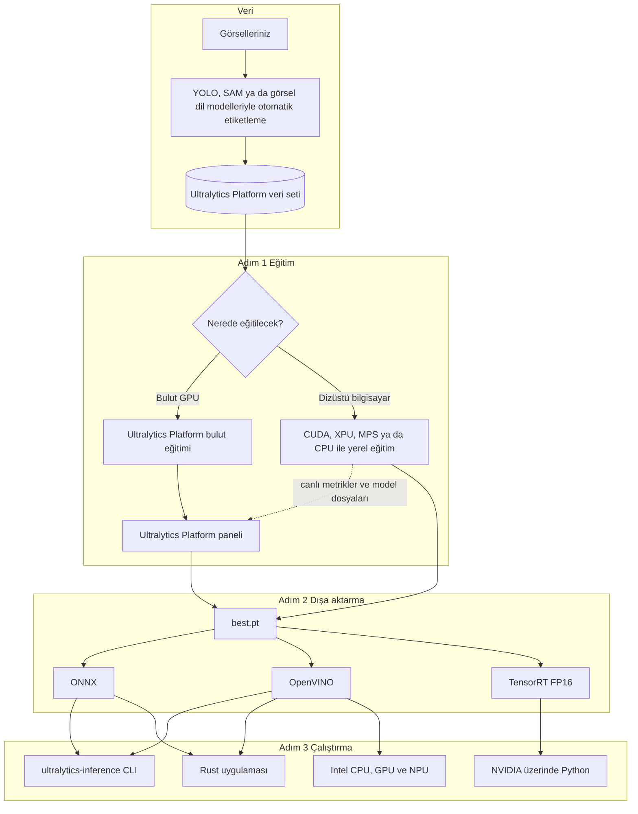

<div class="hero" markdown>

<div class="logos">
  
  
  
  
</div>

<h1><span class="b">Hiçbir</span> <span class="r">GPU</span> <span class="y">Geride</span> <span class="g">Kalmasın</span></h1>

<p class="tagline">Her dizüstü bilgisayarda hibrit Ultralytics YOLO eğitimi ve hızlı çalıştırma. Buluttan Rust'a 60 dakikada.</p>

[:simple-googlecolab: Colab'da aç](https://colab.research.google.com/github/onuralpszr/gdg-samsun-etkinlik-2026-workshop/blob/main/notebooks/hybrid_yolo_workshop.ipynb){ .md-button .md-button--primary }
[:fontawesome-brands-github: Kodu indir](https://github.com/onuralpszr/gdg-samsun-etkinlik-2026-workshop){ .md-button }
[:material-rocket-launch: Ultralytics Platform](https://platform.ultralytics.com){ .md-button }

</div>

## Bugün neler yapacağız :sparkles:

Ciddi bir bilgisayarlı görü projesi için dev bir GPU'ya ihtiyacınız yok. Bugün elinizde ne varsa onunla çalışacağız. Bu bir NVIDIA ekran kartı, Arc grafikli ve NPU'lu bir Intel dizüstü, bir MacBook ya da sadece bir CPU olabilir. Önce bir Ultralytics YOLO modeli eğiteceğiz ve eğitimi canlı olarak **Ultralytics Platform** üzerinden izleyeceğiz. Ardından modeli **ONNX**, **OpenVINO** ve **TensorRT** formatlarına dönüştüreceğiz. Son olarak da **Ultralytics Inference** ile küçük bir Rust uygulaması olarak çalıştıracağız.

<div class="steps" markdown>
<div class="card" markdown>
<strong>:key: Adım 0 Kurulum</strong>
Tek bir betik, donanımınıza uygun PyTorch sürümünü ve OpenVINO'yu içeren bir `.venv` ortamı kurar ve bilgisayarınızdaki tüm hızlandırıcıları kontrol eder.
</div>
<div class="card" markdown>
<strong>:weight_lifter: Adım 1 Eğitim</strong>
`yolo26n.pt` modelini kendi bilgisayarınızda eğitirken metrikleri Ultralytics Platform üzerinde canlı izleyin. Dilerseniz tek tıkla bulut GPU'sunda da eğitebilirsiniz.
</div>
<div class="card" markdown>
<strong>:package: Adım 2 Dışa aktarma</strong>
Modeli ONNX, OpenVINO ve TensorRT formatlarına aktarın ve her formatı sahip olduğunuz tüm cihazlarda yarıştırın.
</div>
<div class="card" markdown>
<strong>:crab: Adım 3 Çalıştırma</strong>
Aynı modeli `ultralytics-inference` CLI aracı ve Rust kütüphanesi ile çalıştırın. Bellek kullanımı sabit kalır ve Python'a hiç gerek kalmaz.
</div>
</div>

## Atölye programı :alarm_clock:

| Zaman | Bölüm | İçerik |
|---|---|---|
| 00:00 | Isınma | Kimde GPU var, kimde NPU var? Herkes katılıyor, kimse geride kalmıyor. |
| 00:05 | Adım 0 | Ön koşul kontrolünü çalıştırıp Ultralytics Platform'a giriş yapıyoruz. |
| 00:12 | Adım 1 | Dizüstü bilgisayarda hibrit eğitim yapıyor, metrikleri Platform'da canlı izliyor ve bulut eğitimini tanıyoruz. |
| 00:25 | Deneme alanı | Yedi görev, nesne takibi, Solutions ve otomatik etiketlemeyi birkaç satır kodla deniyoruz. |
| 00:35 | Adım 2 | Modeli ONNX, OpenVINO ve TensorRT formatlarına aktarıp büyük hız yarışını başlatıyoruz. |
| 00:45 | Adım 3 | Rust ile Ultralytics Inference, CLI, toplu işleme, video ve webcam kullanımını görüyoruz. |
| 00:55 | Kapanış | Canlı webcam gösterisi, faydalı bağlantılar ve soru cevap ile bitiriyoruz. |

## Mimari :world_map:



## Adım 0: Ön koşul kontrolü :white_check_mark:

=== "Linux ve macOS"

    ```bash
    git clone https://github.com/onuralpszr/gdg-samsun-etkinlik-2026-workshop.git
    cd gdg-samsun-etkinlik-2026-workshop
    ./setup_env.sh          # Intel GPU ve NPU bulunan dizüstüler (PyTorch XPU ve OpenVINO)
    ./setup_env.sh cuda     # NVIDIA ekran kartlı bilgisayarlar
    ./setup_env.sh cpu      # Apple silicon (MPS) ve diğer tüm bilgisayarlar
    source .venv/bin/activate
    ```

=== "Windows PowerShell"

    ```powershell
    git clone https://github.com/onuralpszr/gdg-samsun-etkinlik-2026-workshop.git
    cd gdg-samsun-etkinlik-2026-workshop
    uv venv --python 3.13 .venv
    .venv\Scripts\activate
    uv pip install torch torchvision --index-url https://download.pytorch.org/whl/xpu   # NVIDIA için whl/cu130, sadece CPU için whl/cpu
    uv pip install -r requirements.txt
    python local_python/00_check_env.py
    ```

=== "Google Colab"

    Sayfanın en üstündeki **Colab'da aç** düğmesine basın ve **Runtime > Change runtime type > T4 GPU** seçeneğini seçin. Bu yolda bilgisayarınıza hiçbir şey kurmanız gerekmez.

Kontrol betiği PyTorch sürümünü ve bulabildiği tüm hızlandırıcıları listeler. NVIDIA CUDA, Intel XPU ve Apple MPS ile OpenVINO'nun CPU, GPU ve NPU cihazları bu listede yer alır. Ayrıca ONNX Runtime, Rust ve Ultralytics Platform anahtarınızı da kontrol eder, ardından bilgisayarınız için en uygun eğitim ve çıkarım cihazını önerir.

!!! tip "Başlamadan önce kontrol listesi"

    - [x] Python 3.11 ya da üzeri (Ultralytics Platform entegrasyonu için gerekli)
    - [x] `ultralytics` 8.4.120 ya da üzeri
    - [x] Bir Ultralytics Platform hesabı ve API anahtarı
    - [x] Adım 3 için Rust 1.92 ya da üzeri (`curl https://sh.rustup.rs -sSf | sh`)
    - [x] Rust ile video ve webcam kullanacaksanız FFmpeg geliştirme kütüphaneleri

## Adım 1: Ultralytics Platform ve hibrit eğitim :weight_lifter:

### 1.1 API anahtarınızı alın

1. [platform.ultralytics.com](https://platform.ultralytics.com) adresinden ücretsiz hesap açın. Yeni hesaplara başlangıç kredisi tanımlanır.
2. **Settings > API Keys** sayfasına gidin ve eğitim yetkisine sahip bir anahtar oluşturun. Anahtar yalnızca bir kez gösterildiği için hemen kopyalayın.
3. Terminalden giriş yapın. Anahtarınız Ultralytics ayarlarına kaydedilir.

```bash
yolo login ul_your_api_key
# ya da yalnızca bu terminal oturumu için
export ULTRALYTICS_API_KEY=ul_your_api_key
```

### 1.2 Yerelde eğitin, bulutta izleyin

İşin sırrı `project="username/project"` parametresinde. Eğitim **sizin** donanımınızda çalışırken Ultralytics Platform canlı metrikleri, grafikleri, konsol çıktısını ve eğitilen son modeli alır.

=== "Atölye betiği"

    ```bash
    python local_python/01_hybrid_train.py --model yolo26n.pt --data coco8.yaml --epochs 10 --project gdg-samsun
    ```

    Betik önce anahtarınızı doğrular ve kullanıcı adınızı bulur. Ardından `gdg-samsun` adını `username/gdg-samsun` biçimine çevirir. En uygun cihazı (NVIDIA CUDA, Intel XPU, Apple MPS ya da CPU) da kendisi seçer. Anahtarınız yoksa eğitimi çevrimdışı yapar ve anahtarı nereden alabileceğinizi gösterir.

=== "Python"

    ```python
    from ultralytics import YOLO

    model = YOLO("yolo26n.pt")
    # device: NVIDIA CUDA için 0, Intel GPU için "xpu", Apple silicon için "mps", her bilgisayarda "cpu"
    model.train(data="coco8.yaml", epochs=10, device=0, project="your_username/gdg-samsun", name="laptop-run")
    ```

=== "CLI"

    ```bash
    # NVIDIA CUDA için device=0, Intel GPU için device=xpu, Apple silicon için device=mps, her bilgisayarda device=cpu
    yolo train model=yolo26n.pt data=coco8.yaml epochs=10 device=0 project=your_username/gdg-samsun name=laptop-run
    ```

=== "Platform veri seti"

    ```bash
    yolo train model=yolo26n.pt data=ul://your_username/datasets/your_dataset epochs=50 project=your_username/gdg-samsun
    ```

`yolo26n.pt` modelinin `coco8.yaml` üzerinde on epoch eğitimi, bir dizüstü bilgisayar GPU'sunda yaklaşık **18 saniye** sürdü ve **0.941 mAP50** değerine ulaştı.

<div class="gallery" markdown>
<figure markdown>

<figcaption>Eğitim boyunca kayıp ve mAP grafikleri</figcaption>
</figure>
<figure markdown>

<figcaption>Mozaik veri artırma uygulanmış bir eğitim grubu</figcaption>
</figure>
<figure markdown>

<figcaption>10 epoch sonunda doğrulama tahminleri</figcaption>
</figure>
</div>

### 1.3 Ya da tek tıkla bulut GPU'sunda eğitin

1. Ultralytics Platform'da projenizi açın ve **New Model** düğmesine tıklayın.
2. **Official** başlığı altından `YOLO26n` modelini, ardından durumu `ready` olan bir veri setini seçin.
3. Epoch sayısını, batch boyutunu ve görsel boyutunu ayarlayıp bir GPU seçin. Hızlı bir deneme için RTX 2000 Ada yeterlidir.
4. **Start Training** düğmesine basın ve aynı panelin dolmasını izleyin.

Hangi GPU'ların şu anda boşta olduğunu Python ile kontrol edebilirsiniz. Bunun için anahtar gerekmez.

```bash
python local_python/08_platform_tour.py status     # bulut GPU'larının anlık durumu
python local_python/08_platform_tour.py whoami     # plan, kredi ve kayıt sayıları
python local_python/08_platform_tour.py projects   # projeleriniz ve modelleriniz
python local_python/08_platform_tour.py predict --model your_username/gdg-samsun/laptop-run --image bus.jpg
```

## Deneme alanı: Ultralytics YOLO ile neler yapılabilir :art:

[](https://github.com/ultralytics/ultralytics/actions/workflows/ci.yml)
[](https://pypi.org/project/ultralytics/)
[](https://clickpy.clickhouse.com/dashboard/ultralytics)
[](https://pypi.org/project/ultralytics/)
[](https://discord.com/invite/ultralytics)
[](https://community.ultralytics.com)
[](https://www.reddit.com/r/ultralytics/)
[](https://colab.research.google.com/github/ultralytics/ultralytics/blob/main/examples/tutorial.ipynb)
[](https://www.kaggle.com/models/ultralytics/yolo26)

### Yedi görev, tek API

```bash
python local_python/03_all_tasks.py
```

```python
from ultralytics import YOLO

YOLO("yolo26n-pose.pt").predict("https://ultralytics.com/images/zidane.jpg", save=True)
```

<div class="gallery" markdown>
<figure markdown>

<figcaption>detect, <code>yolo26n.pt</code> modeli</figcaption>
</figure>
<figure markdown>

<figcaption>segment, <code>yolo26n-seg.pt</code> modeli</figcaption>
</figure>
<figure markdown>

<figcaption>semantic, <code>yolo26n-sem.pt</code> modeli</figcaption>
</figure>
<figure markdown>

<figcaption>depth, <code>yolo26n-depth.pt</code> modeli</figcaption>
</figure>
<figure markdown>

<figcaption>classify, <code>yolo26n-cls.pt</code> modeli (minibus 0.52)</figcaption>
</figure>
<figure markdown>

<figcaption>pose, <code>yolo26n-pose.pt</code> modeli</figcaption>
</figure>
<figure markdown>

<figcaption>obb, <code>yolo26n-obb.pt</code> modeli (167 gemi, 5 liman)</figcaption>
</figure>
</div>

### Nesne takibi

Her kişi video boyunca aynı ID numarasını korur. Altı takip algoritmasından birini seçebilirsiniz: `botsort`, `bytetrack`, `ocsort`, `deepocsort`, `fasttrack` ve `tracktrack`. Hepsi detect, segment, pose ve obb modelleriyle, dışa aktarılmış formatlar dahil, birlikte çalışır.

```bash
python local_python/04_track.py --model yolo26n_openvino_model --device intel:gpu
python local_python/04_track.py --source 0 --show                     # kendi webcam'iniz
```

<div class="wide" markdown>

</div>

### Solutions ile gerçek hayattan örnekler

```bash
python local_python/06_solutions.py --solution count     # çizgiyi geçen kişileri sayar
python local_python/06_solutions.py --solution heatmap   # kişilerin en çok vakit geçirdiği alanları gösterir
python local_python/06_solutions.py --solution blur      # gizlilik için bulanıklaştırır
python local_python/06_solutions.py --solution speed     # hız tahmini yapar
```

<div class="wide" markdown>

</div>

### Otomatik etiketleme

Elle etiketleme çok zaman alır. Kendi bilgisayarınızda Ultralytics YOLO nesneleri bulur, SAM maskeleri çizer ve YOLO segmentasyon etiketleri kendiliğinden hazırlanır.

Ultralytics Platform ise tarayıcıdaki **Smart Annotation** özelliğiyle bir adım daha ileri gider. Nesnelere SAM 3.1 ile tıklayarak etiketleyebilir, hazır ya da kendi eğittiğiniz Ultralytics YOLO modellerini çalıştırabilir veya sınıf adlarını yazıp tüm veri setini bir görsel dil modeline etiketletebilirsiniz. Platform'da barındırılan sekiz açık kaynak modelden birini (varsayılan olarak Moondream 3.1) seçebilir ya da kendi sağlayıcı anahtarınızı ekleyerek OpenAI, Anthropic, Google ve diğer sağlayıcıların görsel modellerini kullanabilirsiniz.

```bash
python local_python/07_auto_annotate.py
python local_python/07_auto_annotate.py --images path/to/your/images --classes 0 2
```

<div class="gallery" markdown>
<figure markdown>

<figcaption>Tek tıklama yapmadan 5 poligon</figcaption>
</figure>
<figure markdown>

<figcaption>Kravat bile kendi maskesini alıyor</figcaption>
</figure>
</div>

### Canlı webcam

Atölyenin en sevilen bölümü burası. Kamerayı salona çevirin ve çıkarım motorlarını canlı olarak değiştirin.

```bash
python local_python/05_webcam.py                                              # bu bilgisayardaki en uygun cihaz
python local_python/05_webcam.py --model yolo26n_openvino_model --device intel:gpu
python local_python/05_webcam.py --model yolo26n-pose.pt --track
```

## Adım 2: Dışa aktarma ve büyük hız yarışı :package:

```bash
python local_python/02_export_model.py                      # yolo26n.pt modelini ONNX ve OpenVINO'ya aktarır, sonra yarıştırır
python local_python/02_export_model.py --weights runs/detect/gdg-samsun/laptop-run/weights/best.pt
python local_python/02_export_model.py --tensorrt           # NVIDIA kartlarda TensorRT FP16 motorunu da ekler
```

```python
from ultralytics import YOLO

model = YOLO("yolo26n.pt")
model.export(format="onnx", simplify=True)  # her yerde çalışır
model.export(format="openvino")  # Intel CPU, GPU ve NPU için
model.export(format="engine", half=True)  # NVIDIA TensorRT FP16

YOLO("yolo26n_openvino_model").predict("bus.jpg", device="intel:npu")  # evet, NPU üzerinde de çalışır
```

### Atölye bilgisayarındaki sonuçlar

Ölçümler Arc B390 grafik birimi ve dahili NPU bulunan Intel Core Ultra X7 358H işlemcide yapıldı. `yolo26n.pt` modeli 640 boyutunda, `bus.jpg` üzerinde 100 kez çalıştırıldı ve medyan değerler alındı.

| Format | Cihaz | Boyut (MB) | Çıkarım (ms) | Uçtan uca (ms) | FPS | Hızlanma | Nesne |
|---|---|---:|---:|---:|---:|---:|---:|
| PyTorch | cpu | 5.5 | 14.6 | 15.7 | 69 | 1.0x | 5 |
| PyTorch | xpu | 5.5 | 3.2 | 5.3 | 312 | 4.6x | 5 |
| ONNX | cpu | 9.9 | 42.4 | 83.6 | 24 | 0.3x | 5 |
| OpenVINO | intel:cpu | 10.1 | 15.2 | 16.7 | 66 | 1.0x | 5 |
| OpenVINO | intel:gpu | 10.1 | 1.9 | 3.0 | 532 | 7.8x | 5 |
| OpenVINO | intel:npu | 10.1 | 3.2 | 4.7 | 316 | 4.6x | 5 |

!!! success "Öne çıkanlar"

    Dahili Arc GPU üzerinde çalışan OpenVINO, CPU üzerindeki PyTorch'tan **7.8 kat daha hızlı**. NPU ise çok az enerji harcarken dizüstü GPU'sundaki PyTorch ile aynı hıza ulaşıyor. Bu yüzden sürekli açık kalan kameralar için ideal bir seçenek. Model ve doğruluk aynı kaldığı için tüm formatlar aynı kutuları buluyor.

!!! info "NVIDIA GPU'nuz varsa"

    `--tensorrt` parametresini eklediğinizde tabloya bir TensorRT FP16 satırı da eklenir. Colab'da T4 çalışma ortamını seçerseniz notebook bu adımı sizin için yapar.

## Adım 3: Ultralytics Inference ile yüksek hızda çalıştırma :crab:

[](https://crates.io/crates/ultralytics-inference)
[](https://docs.rs/ultralytics-inference)
[](https://crates.io/crates/ultralytics-inference)
[](https://crates.io/crates/ultralytics-inference)
[](https://github.com/ultralytics/inference/actions/workflows/ci.yml)
[](https://app.codecov.io/github/ultralytics/inference)
[](https://github.com/ultralytics/inference/blob/main/LICENSE)
[](https://deps.rs/repo/github/ultralytics/inference)
[](https://arxiv.org/abs/2606.03748)
[](https://discord.com/invite/ultralytics)

Ultralytics Inference, Ultralytics YOLO için geliştirilmiş bir Rust kütüphanesi ve CLI aracıdır. ONNX ve OpenVINO formatındaki modelleri okur, yedi görevin tamamını destekler ve CPU, CUDA, TensorRT, CoreML, OpenVINO gibi pek çok altyapıda çalışır. Tek ve küçük bir uygulama dosyasıdır, çalışırken Python gerektirmez.

### 3.1 CLI aracı

```bash
cargo install ultralytics-inference --features "openvino-native,video"

# OpenVINO native altyapısının çalışma kütüphanesini bulması gerekir, pip paketi bunun için yeterlidir
export LD_LIBRARY_PATH=$(python -c "import openvino, os; print(os.path.dirname(openvino.__file__))")/libs

ultralytics-inference predict --model yolo26n.onnx --source bus.jpg                         # tek görsel
ultralytics-inference predict --model yolo26n.onnx --source images/ --batch 4               # bir klasör
ultralytics-inference predict --model yolo26n_openvino_model --device intel:gpu --source video.mp4
ultralytics-inference predict --model yolo26n_openvino_model --device intel:npu --source 0 --show
ultralytics-inference predict --task pose                                                    # istediğiniz görev, model otomatik iner
```

İsterseniz tüm adımları atölye betiğine bırakabilirsiniz:

```bash
./local_inference/run_cli.sh all          # görsel, klasör, video, tüm görevler, Intel cihazları ve Rust uygulaması
CAMERA=50 ./local_inference/run_cli.sh webcam
```

### 3.2 Kütüphaneyi kendi uygulamanızda kullanın

`local_inference/` klasörü, yaklaşık 200 satırda dört farklı modu olan eksiksiz bir Cargo projesidir.

```toml
[dependencies]
ultralytics-inference = { version = "0.0.54", features = ["openvino-native", "video"] }
```

```rust
use ultralytics_inference::{Device, InferenceConfig, Source, SourceIterator, YOLOModel};

fn main() -> Result<(), Box<dyn std::error::Error>> {
    let config = InferenceConfig::new().with_confidence(0.25).with_device(Device::IntelGpu);
    let mut model = YOLOModel::load_with_config("yolo26n_openvino_model", config)?;

    // Bellekte her an tek bir kare bulunur, 10 saatlik bir yayın da 10 saniyelik bir klip kadar RAM kullanır
    for item in SourceIterator::new(Source::from("video.mp4"))? {
        let (frame, meta) = item?;
        for result in model.predict_image(&frame, meta.path)? {
            println!("{}", result.detection_summary());
        }
    }
    Ok(())
}
```

```bash
cargo build --release --manifest-path local_inference/Cargo.toml --features "openvino,video"
BIN=local_inference/target/release/gdg-inference
$BIN image yolo26n.onnx bus.jpg                                       # tek görsel
$BIN batch yolo26n.onnx datasets/coco8/images/val 4                    # klasördeki görselleri gruplar halinde işler
DEVICE=intel:gpu $BIN video yolo26n_openvino_model video.mp4           # video, webcam ya da RTSP yayını
DEVICE=intel:npu $BIN bench yolo26n_openvino_model bus.jpg 300         # gecikme ölçümü
```

### 3.3 Rust ile yedi görevin tamamı

`--task` parametresini verdiğinizde CLI ilgili YOLO26 nano modelini indirir, örnek görseller üzerinde çalıştırır ve sonuçları `runs/<task>/` klasörüne kaydeder. Aşağıdaki tüm görseller atölye bilgisayarında Rust CLI ile, hiç Python kullanılmadan üretildi.

```bash
./local_inference/run_cli.sh tasks                                    # yedi görevi tek seferde çalıştırır
ultralytics-inference predict --task segment --source bus.jpg         # tek bir görevi kendi görselinizde çalıştırır
```

<div class="gallery" markdown>
<figure markdown>

<figcaption>detect, Python ile aynı kutular</figcaption>
</figure>
<figure markdown>

<figcaption>segment</figcaption>
</figure>
<figure markdown>

<figcaption>semantic</figcaption>
</figure>
<figure markdown>

<figcaption>depth</figcaption>
</figure>
<figure markdown>

<figcaption>classify (minibus 0.53)</figcaption>
</figure>
<figure markdown>

<figcaption>pose</figcaption>
</figure>
<figure markdown>

<figcaption>obb, limandaki tüm gemiler ve rıhtımlar tek tek bulunuyor</figcaption>
</figure>
</div>

### Sonuçlar: Python ve Rust karşılaştırması

Aynı bilgisayar ve aynı `yolo26n` modelleri kullanıldı. Her ölçüm 300 kez çalıştırıldı ve üç denemenin en iyi medyan değeri alındı.

| Motor | Cihaz | Çıkarım (ms) | Uçtan uca (ms) | FPS |
|---|---|---:|---:|---:|
| ONNX Runtime | cpu | 15.65 | 16.33 | 61 |
| OpenVINO | intel:cpu | 24.63 | 25.30 | 40 |
| OpenVINO, THREADS=16 | intel:cpu | 15.04 | 15.80 | 63 |
| OpenVINO | intel:gpu | 1.91 | 2.40 | 417 |
| OpenVINO | intel:npu | 2.19 | 2.73 | 366 |

620 karelik bir kalabalık videosunda işleme hızı ve bellek kullanımı:

| Çalışma ortamı | Motor ve cihaz | Kare | FPS | En yüksek bellek |
|---|---|---:|---:|---:|
| Python Ultralytics YOLO `predict(stream=True)` | intel:gpu üzerinde OpenVINO | 620 | 283 | 942 MB |
| Rust `gdg-inference video` (Ultralytics Inference kütüphanesi) | intel:gpu üzerinde OpenVINO | 620 | 400 | 284 MB |

!!! success "Öne çıkanlar"

    Rust uygulaması yalnızca **37 MB** boyutunda ve Python ortamına ihtiyaç duymuyor. Karşılaştırma için, atölyenin Python `.venv` klasörü 7.9 GB yer kaplıyor. Uçtan uca ölçümlerde Rust, Python'u GPU, NPU ve ONNX Runtime üzerinde geride bırakıyor. CPU'da ise thread sayısı ayarlandığında Python ile aynı seviyeye geliyor. Videoyu **1.4 kat daha hızlı** işliyor ve **3.3 kat daha az bellek** kullanıyor. CPU üzerindeki ONNX Runtime süresi Python'da 83.6 ms iken Rust'ta 16.3 ms'ye düşüyor.

!!! tip "Hibrit işlemcilerde CPU thread sayısı"

    Intel hibrit işlemcilerde Rust tarafındaki OpenVINO, kullanacağı thread sayısını varsayılan olarak kendisi belirler. Atölye uygulamasına `THREADS=16` (tüm çekirdekler) verirseniz ya da kodda `.with_threads(16)` kullanırsanız CPU üzerindeki çıkarım yaklaşık 1.6 kat hızlanır.

## Mini görevler :trophy:

- [ ] `06_solutions.py --solution count --model yolo26n_openvino_model --device intel:npu` komutuyla kameranın önünden geçen kişileri NPU üzerinde sayın.
- [ ] `02_export_model.py` ile kendi bilgisayarınızdaki en hızlı cihazı bulun ve sonuç tablosunu paylaşın.
- [ ] Telefonunuzdan on fotoğraf seçip otomatik etiketleyin ve Ultralytics Platform'a veri seti olarak yükleyin.
- [ ] `yolo26n-pose.pt` modeli ve `--track` seçeneğiyle webcam üzerinden arkadaşlarınızı takip edin.
- [ ] Rust uygulamasını derleyin ve kendi bilgisayarınızda Python'un FPS değerini geçin.

## Sorun giderme :wrench:

??? question "Webcam 0 numaralı cihazla açılmıyor"

    Yeni dizüstü bilgisayarların çoğu kamerayı bir Intel IPU ve v4l2loopback cihazı üzerinden sunar. `v4l2-ctl --list-devices` komutuyla cihazları listeleyin ve loopback cihazının numarasını kullanın. Örneğin Python için `--camera 50`, `run_cli.sh` için `CAMERA=50` yazabilirsiniz.

??? question "OpenVINO intel:gpu ya da intel:npu cihazını listelemiyor"

    `python -c "import openvino as ov; print(ov.Core().available_devices)"` komutunu çalıştırın. Listede GPU ya da NPU yoksa dağıtımınız için Intel GPU compute runtime paketini ve NPU sürücüsünü kurun, ardından bilgisayarı yeniden başlatın.

??? question "Rust CLI libopenvino_c kütüphanesini bulamıyor"

    Adım 3.1'de gösterildiği gibi `LD_LIBRARY_PATH` değişkenini `openvino` pip paketinin `libs` klasörüne yönlendirin. `run_cli.sh` bu ayarı sizin için otomatik yapar.

??? question "PyTorch GPU'mu görmüyor"

    PyTorch'un neleri gördüğünü öğrenmek için `python local_python/00_check_env.py` komutunu çalıştırın. NVIDIA kartlar için `./setup_env.sh cuda` ile kurulan CUDA sürümü ve güncel bir sürücü gerekir. Intel GPU'lar için `./setup_env.sh` ile kurulan XPU sürümü ve güncel bir Intel GPU sürücüsü gerekir. Apple silicon ise `./setup_env.sh cpu` ile kurulan sürümde MPS üzerinden çalışır.

??? question "Eğitim Ultralytics Platform'da görünmüyor"

    Python 3.11 ya da üzeri, `ultralytics` 8.4.120 ya da üzeri, `yolo login` ile kaydedilmiş geçerli bir anahtar ve `username/project` biçiminde bir `project` değeri gerekir.

## Depo haritası :file_folder:

| Yol | Açıklama |
|---|---|
| `setup_env.sh` | CUDA, Intel XPU ya da CPU için PyTorch ile OpenVINO içeren `.venv` ortamını kurar |
| `local_python/00_check_env.py` | Tüm hızlandırıcılar için ön koşul kontrolü yapar |
| `local_python/01_hybrid_train.py` | Ultralytics Platform girişi ve hibrit eğitimi yürütür |
| `local_python/02_export_model.py` | ONNX, OpenVINO ve TensorRT dışa aktarımı ile hız yarışını yapar |
| `local_python/03_all_tasks.py` | detect, segment, semantic, depth, classify, pose ve obb görevlerini çalıştırır |
| `local_python/04_track.py` | Video ya da webcam üzerinde çoklu nesne takibi yapar |
| `local_python/05_webcam.py` | FPS sayacıyla canlı webcam görüntüsü gösterir |
| `local_python/06_solutions.py` | Sayma, ısı haritası, gizlilik bulanıklaştırma ve hız tahmini yapar |
| `local_python/07_auto_annotate.py` | Ultralytics YOLO ve SAM ile otomatik etiketleme yapar |
| `local_python/08_platform_tour.py` | Ultralytics Platform Python istemcisini tanıtır |
| `local_python/device_utils.py` | NVIDIA CUDA, Intel XPU, Apple MPS ve CPU arasından en uygun cihazı seçer |
| `local_inference/` | `ultralytics-inference` için Rust Cargo projesi ve `run_cli.sh` betiği |
| `notebooks/hybrid_yolo_workshop.ipynb` | Atölyenin tamamını Google Colab üzerinde sunar |
| `tools/` | Notebook üretici ve yazım stili kontrol aracı |

## İletişimde kalalım :handshake:

<div class="qr" markdown>
<div markdown>


**Bu atölye sayfası**
</div>
<div markdown>


**Ultralytics Platform'a katılın**
</div>
</div>

- :rocket: [Ultralytics Platform](https://platform.ultralytics.com) ve [Platform dokümantasyonu](https://docs.ultralytics.com/platform/)
- :crab: [GitHub'da Ultralytics Inference](https://github.com/ultralytics/inference) ve [crates.io sayfası](https://crates.io/crates/ultralytics-inference)
- :books: [Ultralytics YOLO dokümantasyonu](https://docs.ultralytics.com)
- :speech_balloon: [Ultralytics Discord topluluğu](https://discord.com/invite/ultralytics)

Bugün hiçbir GPU geride kalmadı. Katıldığınız için teşekkürler Samsun! :tada:
